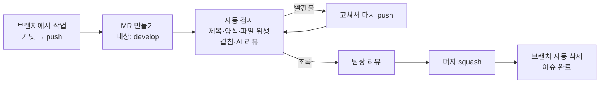
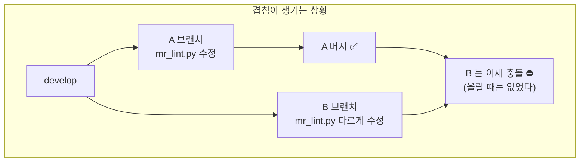
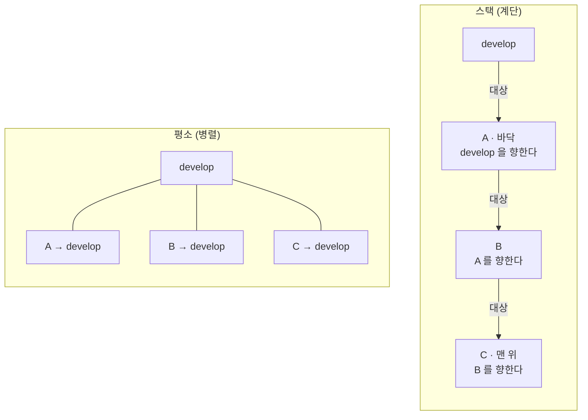
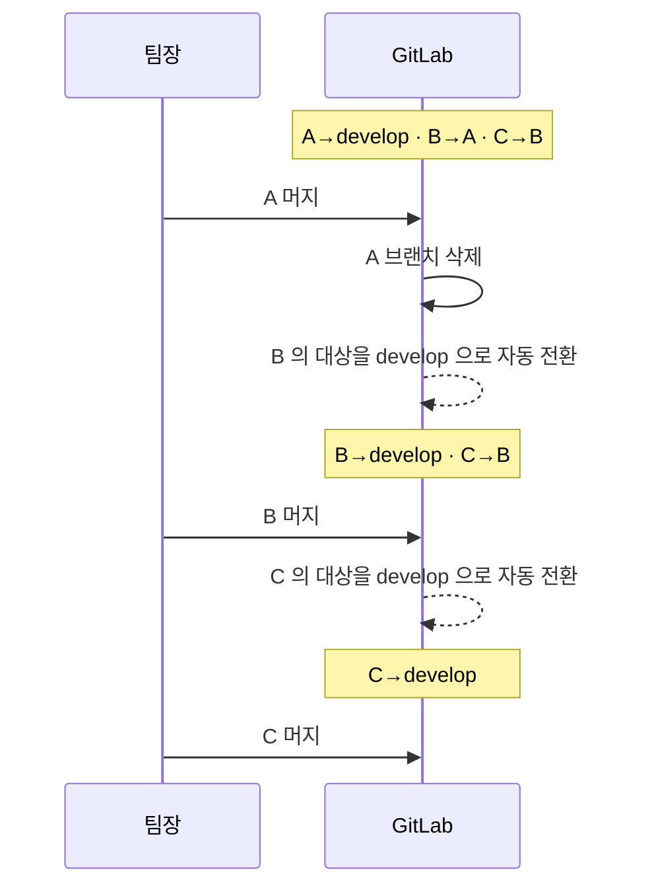

# MR 흐름 — 올리기부터 머지까지

MR을 제출하고 검사 실패나 다른 MR과의 충돌을 해결하는 절차입니다. 변경이 겹치면 의존 관계를 확인해 스택을 구성하고, `develop`에 가까운 부모 MR부터 머지합니다.

[문서 안내](README.md) · 이름·커밋 규칙: [Git 컨벤션](git-convention.md) · 검사 상세: [CI/CD 구조](ci-cd-pipeline.md)

스택 운영 규칙은 2026-08-28에 MR 9건의 충돌을 정리한 경험을 바탕으로 정했습니다.

**이 문서의 내용**

- [1. MR 하나가 머지되기까지](#section-1)
- [2. 다른 MR 과 같은 파일을 고쳤다면](#section-2)
- [3. 스택 — 계단처럼 쌓기](#section-3)
- [4. 언제 스택을 쓰나](#section-4)
- [5. 자주 나오는 질문](#section-5)

<a id="section-1"></a>

## 1. MR 하나가 머지되기까지



작성자는 **push 후 검사 결과를 확인하고, 실패 원인을 수정한 뒤 리뷰를 요청**합니다. 제목 형식·이슈 키 채우기·develop 최신 반영은 자동으로 됩니다.

**MR은 push 뒤 터미널에 훅이 찍어 주는 링크(`➜ push 가 끝나면 이 링크로…`)로 만드세요** — 제목(마지막 커밋 제목)과 대상 브랜치가 채워져 있고 본문 템플릿은 GitLab이 넣습니다. GitLab이 찍어 주는 기본 링크로 만들어도 됩니다: 제목 칸은 비울 수 없어 브랜치 이름이 들어가는데, CI가 1분 안에 Jira 기준으로 `[파트] type: 요약 (키)`로 고칩니다.

<a id="section-2"></a>

## 2. 다른 MR 과 같은 파일을 고쳤다면

여기가 오늘 문제가 된 부분입니다. 먼저 **왜 생기는지** 보세요.



A·B 각각은 develop과 충돌이 없습니다. 그런데 **A가 먼저 머지되는 순간 B가 충돌**합니다. 머지할 때가 되어서야 드러나는 게 문제였습니다.

### 이제는 MR 올릴 때 알려 줍니다

`mr-overlap` 검사가 열려 있는 다른 MR 마다 **실제로 합쳐 보고**(git이 판정합니다, 추측이 아닙니다) 결과를 양쪽 MR 코멘트에 남깁니다.

| 상황 | 나중에 올린 MR | 먼저 올린 MR |
| --- | --- | --- |
| 같은 줄을 다르게 고쳤다 | 🔴 **검사 실패** + 고칠 명령 | ⚠ 정보 + "먼저 머지해 주세요" |
| 같은 씬·프리팹을 만졌다(텍스트 충돌은 없음) | ⚠ 경고 | ⚠ 경고 |
| 같은 파일이지만 자동 병합됨 | ℹ 참고만 | — |

**나중에 올린 사람이 맞춥니다.** 먼저 올린 사람은 그대로 진행합니다.

### 고치는 방법 — 앞 MR 위에 얹기

```bash
# 앞 MR 의 브랜치 이름은 코멘트에 적혀 있습니다
git fetch origin <앞-MR-브랜치>
git rebase origin/<앞-MR-브랜치>      # 씬·프리팹이 겹치면 rebase 대신 merge 를 쓰세요
git push --force-with-lease
```

씬·프리팹이 겹칠 때는 충돌을 한 번에 보는 쪽이 낫습니다.

```bash
git fetch origin <앞-MR-브랜치>
git merge origin/<앞-MR-브랜치>       # 커밋 해시가 그대로라 강제 push 가 필요 없습니다
git push
```

`--force-with-lease`는 그 사이 남이 올린 커밋이 있으면 거부합니다 — 남의 작업을 덮어쓰지 않습니다.

<a id="section-3"></a>

## 3. 스택 — 계단처럼 쌓기

앞 MR 위에 얹어 push 하면 검사가 그것을 알아보고 **대상 브랜치를 앞 MR의 브랜치로 자동 전환**합니다. 이렇게 쌓인 모양을 스택이라고 부릅니다.



**스택을 사용하는 이유**: B가 A의 변경을 포함한 상태에서 이어서 작업하면 두 변경의 의존 관계를 명확히 할 수 있습니다. 이후 A가 수정되면 B에도 반영하고 충돌 여부를 다시 확인합니다.

**리뷰도 쉬워집니다**: GitLab은 diff를 대상 브랜치 기준으로 보여 줍니다. B의 MR 에는 **B가 한 것만** 보입니다.

### 머지는 아래(develop 에 가까운 쪽)부터

한 칸씩 내려옵니다. 헷갈리기 쉬운 부분이니 그림으로 보세요.



### 순서는 CI 가 강제합니다 (2026-09-01 부터)

대상이 **다른 이슈의 작업 브랜치**인 MR은 `stack-order` 검사가 **실패합니다.** 부모가 develop에
들어가기 전까지 이 MR은 머지 대상이 아니라는 뜻입니다.

- **부모 MR의 머지를 기다립니다.** 부모가 develop에 머지되면 GitLab이 이 MR의
  대상을 develop으로 되돌리고, 그때 이
  검사가 **저절로 통과**합니다. 이유는 MR 코멘트로도 남습니다.
- 🔴 CI 실패 카드는 보내지 않습니다 — 작성자가 무엇을 잘못한 것이 아니라 아직 순서가 아닐 뿐입니다.
- 왜 이렇게까지 하는가: 2026-09-01 실측으로 **스택 머지 26건이 전부 이 순서를 어겼습니다**(지킨 것 0건).
  `mr-lint`는 이미 같은 조건을 경고로 달고 있었지만 "머지를 막지는 않는다" 는 문구 그대로 무시됐습니다.
  그래서 결과가 아래처럼 됐습니다 — MR 하나가 이슈 3건의 변경을 실어 갔고, 팀장이 리뷰한 내용과
  머지된 내용이 달랐습니다.
- **Draft는 쓰지 않습니다.** 팀 규칙이 Draft를 금지하기 때문입니다(`git-convention.md` §5).
  CI가 그 상태를 대신 쓰면 규칙에 예외가 생기고, 사람이 그 예외를 흉내 내 검사를 우회할 수 있습니다.
- 부모가 이미 머지됐는데(브랜치가 사라졌거나, 브랜치만 남아 있거나) 대상이 그대로면 CI가 대상을
  develop으로 **되돌리고 통과시킵니다** — 잘못 차단되는 경우를 만들지 않습니다.
- **머지 버튼까지 잠기는 것은** 프로젝트 설정 `Settings → Merge requests → Pipelines must succeed`
  가 켜진 뒤입니다. 그 전까지는 빨간 X와 코멘트가 남습니다.

  > **주의 — 자동 재대상에는 파이프라인이 따라오지 않습니다.** 예전에 여기에 "대상이 바뀌면 1초 안에
  > 새 파이프라인이 생긴다" 고 적어 뒀는데, 그건 **API 로 대상을 바꿨을 때만** 참이었습니다.
  > GitLab 이 브랜치 삭제로 자동 재대상할 때는 파이프라인을 만들지 않습니다 — 09-02~04 재대상
  > 16건 중 **14건 미생성**(생긴 2건은 API 재대상 `!204`, 직후 커밋 push `!210`).
  > 그러면 자식에 남은 마지막 결과는 **부모 브랜치 위에서 돈 것**입니다. develop 기준으로는 한 번도
  > 검사받지 않았는데 초록으로 보입니다. `retarget-pipelines` 잡이 이걸 메웁니다(`-295`).

**맨 위(C)부터 머지하면 안 됩니다.** ① C의 대상은 develop이 아니라 B 브랜치라서, 머지해도 develop 에는 아무것도 도착하지 않고 B 브랜치 안으로 들어갑니다. 그러면 나중에 B를 머지할 때 두 이슈가 커밋 하나로 뭉치고, **C의 Jira 이슈는 자동 완료되지 않습니다**(완료는 develop에 머지될 때만 일어납니다).

② 그리고 **부모 MR의 내용이 리뷰 후에 바뀝니다.** C가 B 브랜치로 들어가면 B의 MR은 리뷰받은 것과 다른 내용을 갖게 되고, 결국 B 하나가 여러 이슈의 변경을 실어 develop에 들어갑니다. develop 커밋 하나에 여러 이슈가 뭉치면 되돌릴 때 분리도 안 됩니다.

### 스택 MR 은 올린 직후 빨간불이 둘입니다 — 고칠 것이 없습니다

스택 MR(대상이 develop 이 아니라 작업 브랜치)을 올리면 **검사 두 개가 반드시 실패**합니다. 둘 다
**부모가 머지되면 저절로 풀립니다.** 이걸 모르면 고칠 것을 찾다 시간을 버리거나, 더 나쁘게는
"빨간불은 무시하는 것" 이 됩니다.

| 검사 | 왜 빨간불인가 | 언제 풀리나 |
| --- | --- | --- |
| `stack-order` | **의도적인 하드 블록**입니다(`-244`). 부모보다 먼저 머지되는 것을 막습니다 | 부모가 develop 에 들어가면 통과하고, 잡이 **자기 스레드까지 스스로 해소**합니다 |
| `unity-compile` | **기준선이 없습니다.** 이 잡은 "이 MR 이 새로 만든 실패" 만 막으려고 대상 브랜치의 최근 CI 이력을 기준선으로 씁니다. 그런데 대상이 작업 브랜치면 그 이력이 없어 새 실패인지 가릴 수 없습니다 → 판정 "판단 불가" | 대상이 develop 으로 되돌아가면 develop 기준선을 씁니다 |

`stack-order` 잡의 코멘트가 그 사실을 직접 적습니다 — **"이 MR 은 고칠 것이 없고, 부모가 머지되면
이 검사는 저절로 통과한다."** 그 문장이 보이면 다른 곳을 뒤지지 마세요.

`unity-compile` 이 "판단 불가" 로 빨간불이 되는 것은 일부러 그렇게 둔 것입니다. **확인하지 못한 것을
"이상 없다" 로 접지 않는다**는 규칙(`-309`)이 여기에도 적용됩니다 — 다만 스택에서는 그것이 구조적으로
일어나므로, 위 표를 보고 판단하면 됩니다.

> **덤으로 알아 둘 것.** `unity-compile` 은 `METAGAME/**/*` 가 바뀌면 돕니다. 그래서
> `METAGAME/README.md` 처럼 **문서만 고쳐도** Unity 임포트·컴파일·테스트가 한 번 돕니다.
> 스택이 아니어도 그렇습니다.

### 부모가 머지된 뒤 (스택을 쓰는 사람이 알아야 할 것)

> **자식 MR 은 새 파이프라인이 통과할 때까지 머지 버튼이 잠깁니다**(`-297`).
> `stack-order` 가 다는 🔒 안내는 평범한 코멘트가 아니라 **미해소 스레드**입니다. 프로젝트 설정
> `All threads must be resolved` 가 켜져 있으므로 그 스레드가 미해소인 동안 머지가 안 됩니다.
>
> 왜 검사 실패만으로 부족한가: `Pipelines must succeed` 는 MR 의 **마지막 파이프라인**만 봅니다.
> 부모가 머지돼 자식이 재대상되면 그 마지막 파이프라인은 **부모 기준으로 통과한 낡은 초록**이라
> GitLab 이 머지를 허용합니다. 실측한 재대상 → 머지 간격 중위값이 약 20초라 그 창에 들어갑니다.
>
> **이 스레드를 손으로 해소하지 마세요.** 아직 순서가 아니라는 사실은 클릭으로 바뀌지 않으므로
> 다음 파이프라인이 다시 미해소로 되돌립니다. 부모를 머지하면 `retarget-pipelines` 가 새
> 파이프라인을 만들고(`-295`), 거기서 `stack-order` 가 통과하면서 스레드가 저절로 풀립니다.

**순서를 지키면 Jira 이슈 완료는 저절로 됩니다.** 아래부터 머지하면 자식 MR도 결국 **develop을 대상으로**
머지되므로, 그때 자동 완료(R6)가 각 이슈를 완료로 옮깁니다. 따로 할 일이 없습니다.

> **순서를 어기면 이슈가 남습니다.** 자식을 부모 브랜치로 먼저 머지하면 develop 에 도착한 것이 없으므로
> R6 가 그 이슈를 건드리지 않습니다(정상 동작입니다). 과거에는 **담당자가 손으로 완료로 옮기는 방식**으로 처리했습니다. 현재 자동화가 전환을 되돌리면 Infra에 `automation-missed` 적용을 요청합니다 —
> 다음날 아침 점검의 `🔗`·`🧩` 항목에 담당자와 함께 표시됩니다.
>
> 한동안 CI 가 그것까지 대신 옮기는 안전망(`jira-complete`)을 뒀지만 **없앴습니다**(-242). 순서를 CI 가  <!-- drift-ok -->
> 막게 된 뒤로는 정상 순서에서 그 잡이 매번 "이미 완료" 만 찍었습니다 — 할 일이 없었습니다. 그리고
> **Jira 상태는 Jira 자동화가, CI 는 검사·알림만** 맡는 편이 경계가 깨끗합니다: 러너가 꺼져 있어도
> 이슈 완료가 영향받지 않고, 팀 공용 CI 변수에 쓰기 권한을 두지 않습니다.

브랜치 정리는 여전히 손으로 합니다. 우리는 squash 머지를 쓰기 때문에, A가 머지되면 develop 에는 **커밋 하나로 새 해시**가 생깁니다. 내 브랜치에는 A의 원래 커밋들이 그대로 있어서 diff가 부풀어 보일 수 있습니다. 그때는 자기 커밋만 옮깁니다.

```bash
git fetch origin
git rebase --onto origin/develop <A 의 옛 끝 커밋> <내 브랜치>
git push --force-with-lease
```

`<A 의 옛 끝 커밋>`은 `git log --oneline`에서 내 첫 커밋 바로 아래에 있는 커밋입니다.

<a id="section-4"></a>

## 4. 언제 스택을 쓰나

| 상황 | 어떻게 |
| --- | --- |
| 같은 파일을 이어서 고치는 작업이 여러 개 | **스택** — 애초에 충돌이 생기지 않습니다 |
| 파일이 겹치지 않는 독립 작업 | **평소대로 병렬** — 모두 develop을 향하게 |
| 앞 작업이 아직 리뷰 중인데 이어서 해야 함 | **스택** |
| 스택이 4단을 넘어갈 것 같다 | 멈추고 앞부터 머지받으세요. 한 MR이 막히면 위가 전부 막힙니다 |

같은 파일을 연속해서 수정하는 작업은 의존 관계를 확인하고, 한 작업으로 검토할 수 있는 범위라면 하나의 MR로 묶습니다. 2026-08-28 에 CI 스크립트 5개 파일을 9개 MR이 나눠 고쳤던 것이 문제의 절반이었습니다.

<a id="section-5"></a>

## 5. 자주 나오는 질문

**파이프라인은 초록인데 머지 버튼이 잠겨 있습니다.** 미해소 스레드가 남아 있는 것입니다. 이 프로젝트는 "모든 스레드 해결" 을 머지 조건으로 켜 두었기 때문에, 검사가 전부 통과해도 스레드 하나가 남으면 머지되지 않습니다. 잠긴 이유가 어디에도 표시되지 않아 알기 어려웠는데, 2026-09-10 부터 `mr-lint` 가 미해소 스레드 개수와 남긴 사람을 확인 사항으로 알려 줍니다. MR 화면의 "미해결 스레드" 를 눌러 찾아가 해결 처리하세요.

**코멘트에 답할 때는 그 스레드 안에서 답글을 쓰고, 답을 마쳤으면 해결 처리하세요.** 새 코멘트를 따로 쓰면 그것이 **새 스레드**가 되어, 답을 한 쪽이 오히려 머지를 잠급니다. 2026-09-10 에 `!320`·`!321`·`!322`·`!324` 네 건이 이 상태로 조용히 멈춰 있었습니다 — 전부 초록이었고 카드도 오지 않았습니다. 봇 코멘트(🤖·🔀·🔴)는 조건이 해소되면 스스로 정리되니 사람이 손댈 필요가 없습니다.

**push 하면 "리베이스했습니다, 다시 push 하세요" 가 나옵니다.** 정상입니다. develop이 앞서 있어서 훅이 최신을 얹어 준 것이고, git은 push 직전에 보낼 커밋을 이미 확정하기 때문에 그 push만 중단됩니다. 안내된 명령으로 한 번 더 push 하면 됩니다.

**스택 브랜치인데 훅이 자동 반영을 건너뜁니다.** 의도된 동작입니다. 스택 브랜치를 develop 위로 옮기면 부모 커밋이 복제되어 스택이 깨집니다. 부모가 먼저 최신을 얹은 뒤 그 위에서 따라가세요: `git fetch origin <부모> && git rebase origin/<부모>`.

**대상 브랜치가 저절로 바뀌었습니다.** 두 경우입니다. ① 앞 MR 위에 얹혀 있어서 검사가 전환한 것 ② 부모 MR이 머지되어 GitLab이 develop으로 되돌린 것. 둘 다 정상입니다. 원하지 않으면 MR 화면에서 대상을 직접 바꿔도 됩니다.

**충돌 코멘트가 왔는데 내가 먼저 올린 MR 입니다.** 그대로 진행하세요. 팀장이 이 MR을 먼저 머지하고, 나중 MR 작성자가 그 위에 얹습니다.

**아침에 📋 카드에 "서로 충돌하는 열린 MR" 표가 옵니다.** 그날의 머지 순서 지도입니다. 앞의 것을 먼저 머지하고 뒤의 것은 그 위에 얹으면 됩니다.

---

관련 문서: [git-convention.md](./git-convention.md)(브랜치·커밋 규칙) · [ci-and-notifications.md](./ci-and-notifications.md)(검사 잡별 상세) · [workflow.md](./workflow.md)(전체 흐름) · [e2e-checklist.md](./e2e-checklist.md)(어긋나는 시나리오 정의와 실측)
