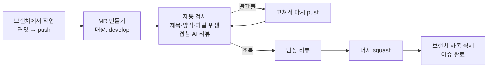
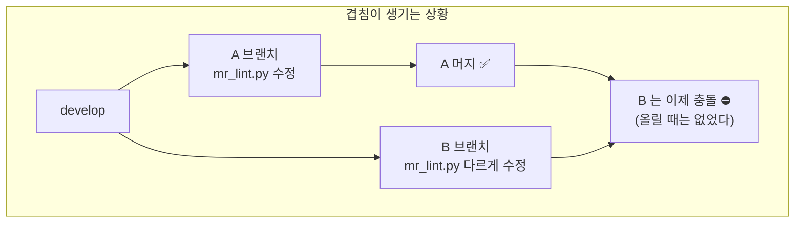
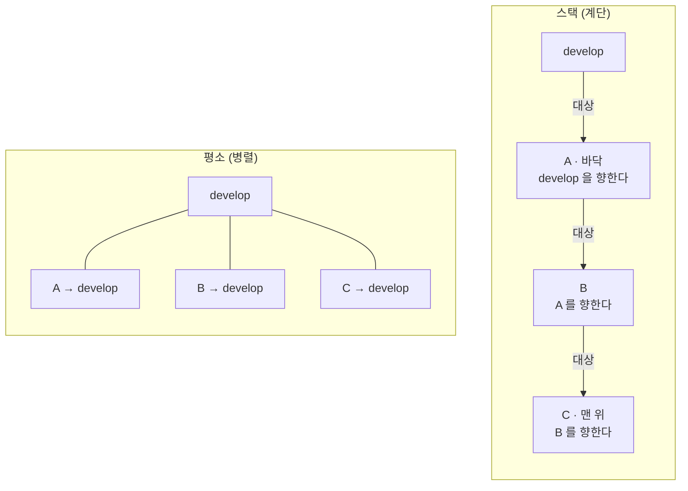
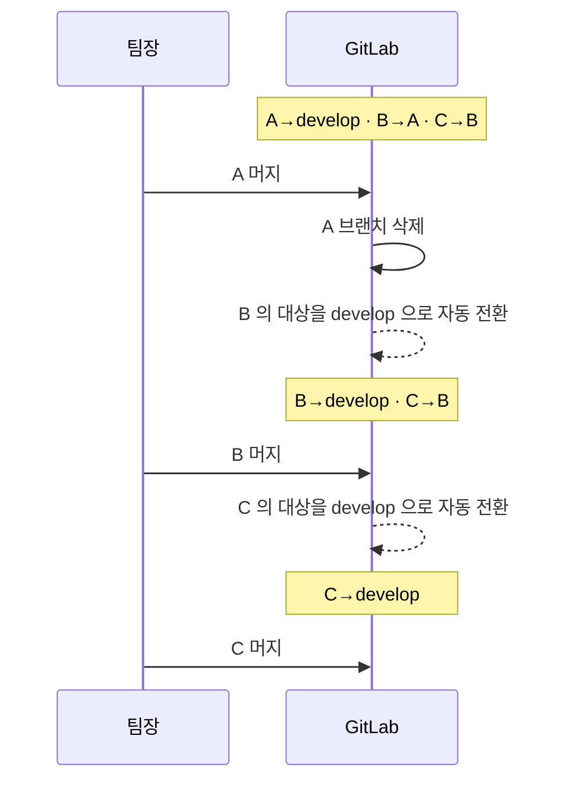

# MR 흐름 — 올리기부터 머지까지

MR 을 올릴 때 무엇이 자동으로 검사하는지, 그리고 **다른 사람 MR 과 같은 파일을 고쳤을 때** 어떻게 하는지 정리한 문서입니다. 뒤쪽 "스택" 부분은 2026-08-28 에 MR 9건이 서로 충돌해 전부 다시 정리한 뒤 정한 규칙입니다.

## 1. MR 하나가 머지되기까지



내가 할 일은 **push 하고, 빨간불이면 고치고, 초록이면 기다리기**입니다. 제목 형식·이슈 키 채우기·develop 최신 반영은 자동으로 됩니다.

## 2. 다른 MR 과 같은 파일을 고쳤다면

여기가 오늘 문제가 된 부분입니다. 먼저 **왜 생기는지** 보세요.



A·B 각각은 develop 과 충돌이 없습니다. 그런데 **A 가 먼저 머지되는 순간 B 가 충돌**합니다. 머지할 때가 되어서야 드러나는 게 문제였습니다.

### 이제는 MR 올릴 때 알려 줍니다

`mr-overlap` 검사가 열려 있는 다른 MR 마다 **실제로 합쳐 보고**(git 이 판정합니다, 추측이 아닙니다) 결과를 양쪽 MR 코멘트에 남깁니다.

| 상황 | 나중에 올린 MR | 먼저 올린 MR |
| --- | --- | --- |
| 같은 줄을 다르게 고쳤다 | 🔴 **검사 실패** + 고칠 명령 | ⚠ 정보 + "먼저 머지해 주세요" |
| 같은 씬·프리팹을 만졌다(텍스트 충돌은 없음) | ⚠ 경고 | ⚠ 경고 |
| 같은 파일이지만 자동 병합됨 | ℹ 참고만 | — |

**나중에 올린 사람이 맞춥니다.** 먼저 올린 사람은 그대로 진행합니다.

### 고치는 방법 — 앞 MR 위에 얹기

```bash
# 앞 MR 의 브랜치 이름은 코멘트에 적혀 있습니다
git fetch origin <앞-MR-브랜치>
git rebase origin/<앞-MR-브랜치>      # 씬·프리팹이 겹치면 rebase 대신 merge 를 쓰세요
git push --force-with-lease
```

씬·프리팹이 겹칠 때는 충돌을 한 번에 보는 쪽이 낫습니다.

```bash
git fetch origin <앞-MR-브랜치>
git merge origin/<앞-MR-브랜치>       # 커밋 해시가 그대로라 강제 push 가 필요 없습니다
git push
```

`--force-with-lease` 는 그 사이 남이 올린 커밋이 있으면 거부합니다 — 남의 작업을 덮어쓰지 않습니다.

## 3. 스택 — 계단처럼 쌓기

앞 MR 위에 얹어 push 하면 검사가 그것을 알아보고 **대상 브랜치를 앞 MR 의 브랜치로 자동 전환**합니다. 이렇게 쌓인 모양을 스택이라고 부릅니다.



**왜 충돌이 없어지나**: B 는 A 의 변경을 **이미 갖고 있습니다**. 같은 파일을 고쳤어도 "충돌" 이 아니라 "이어서 고친 것" 입니다.

**리뷰도 쉬워집니다**: GitLab 은 diff 를 대상 브랜치 기준으로 보여 줍니다. B 의 MR 에는 **B 가 한 것만** 보입니다.

### 머지는 아래(develop 에 가까운 쪽)부터

한 칸씩 내려옵니다. 헷갈리기 쉬운 부분이니 그림으로 보세요.



### 순서는 CI 가 강제합니다 (2026-09-01 부터)

대상이 **다른 이슈의 작업 브랜치**인 MR 은 `stack-order` 검사가 **실패합니다.** 부모가 develop 에
들어가기 전까지 이 MR 은 머지 대상이 아니라는 뜻입니다.

- **고칠 것은 없습니다. 그 MR 은 잘못되지 않았습니다.** 부모가 develop 에 머지되면 GitLab 이 이 MR 의
  대상을 develop 으로 되돌리고, 그때 이
  검사가 **저절로 통과**합니다. 이유는 MR 코멘트로도 남습니다.
- 🔴 CI 실패 카드는 보내지 않습니다 — 작성자가 무엇을 잘못한 것이 아니라 아직 순서가 아닐 뿐입니다.
- 왜 이렇게까지 하는가: 2026-09-01 실측으로 **스택 머지 26건이 전부 이 순서를 어겼습니다**(지킨 것 0건).
  `mr-lint` 는 이미 같은 조건을 경고로 달고 있었지만 "머지를 막지는 않는다" 는 문구 그대로 무시됐습니다.
  그래서 결과가 아래처럼 됐습니다 — MR 하나가 이슈 3건의 변경을 실어 갔고, 팀장이 리뷰한 내용과
  머지된 내용이 달랐습니다.
- **Draft 는 쓰지 않습니다.** 팀 규칙이 Draft 를 금지하기 때문입니다(`git-convention.md` §5).
  CI 가 그 상태를 대신 쓰면 규칙에 예외가 생기고, 사람이 그 예외를 흉내 내 검사를 우회할 수 있습니다.
- 부모가 이미 머지됐는데(브랜치가 사라졌거나, 브랜치만 남아 있거나) 대상이 그대로면 CI 가 대상을
  develop 으로 **되돌리고 통과시킵니다** — 억울하게 막히는 경우를 만들지 않습니다.
- **머지 버튼까지 잠기는 것은** 프로젝트 설정 `Settings → Merge requests → Pipelines must succeed`
  가 켜진 뒤입니다. 그 전까지는 빨간 X 와 코멘트가 남습니다.

  > **주의 — 자동 재대상에는 파이프라인이 따라오지 않습니다.** 예전에 여기에 "대상이 바뀌면 1초 안에
  > 새 파이프라인이 생긴다" 고 적어 뒀는데, 그건 **API 로 대상을 바꿨을 때만** 참이었습니다.
  > GitLab 이 브랜치 삭제로 자동 재대상할 때는 파이프라인을 만들지 않습니다 — 09-02~04 재대상
  > 16건 중 **14건 미생성**(생긴 2건은 API 재대상 `!204`, 직후 커밋 push `!210`).
  > 그러면 자식에 남은 마지막 결과는 **부모 브랜치 위에서 돈 것**입니다. develop 기준으로는 한 번도
  > 검사받지 않았는데 초록으로 보입니다. `retarget-pipelines` 잡이 이걸 메웁니다(`-295`).

**맨 위(C)부터 머지하면 안 됩니다.** ① C 의 대상은 develop 이 아니라 B 브랜치라서, 머지해도 develop 에는 아무것도 도착하지 않고 B 브랜치 안으로 들어갑니다. 그러면 나중에 B 를 머지할 때 두 이슈가 커밋 하나로 뭉치고, **C 의 Jira 이슈는 자동 완료되지 않습니다**(완료는 develop 에 머지될 때만 일어납니다).

② 그리고 **부모 MR 의 내용이 리뷰 후에 바뀝니다.** C 가 B 브랜치로 들어가면 B 의 MR 은 리뷰받은 것과 다른 내용을 갖게 되고, 결국 B 하나가 여러 이슈의 변경을 실어 develop 에 들어갑니다. develop 커밋 하나에 여러 이슈가 뭉치면 되돌릴 때 분리도 안 됩니다.

### 부모가 머지된 뒤 (스택을 쓰는 사람이 알아야 할 것)

**순서를 지키면 Jira 이슈 완료는 저절로 됩니다.** 아래부터 머지하면 자식 MR 도 결국 **develop 을 대상으로**
머지되므로, 그때 자동 완료(R6)가 각 이슈를 완료로 옮깁니다. 따로 할 일이 없습니다.

> **순서를 어기면 이슈가 남습니다.** 자식을 부모 브랜치로 먼저 머지하면 develop 에 도착한 것이 없으므로
> R6 가 그 이슈를 건드리지 않습니다(정상 동작입니다). 그때는 **담당자가 손으로 완료로 옮깁니다** —
> 다음날 아침 점검의 `🔗`·`🧩` 항목에 담당자와 함께 표시됩니다.
>
> 한동안 CI 가 그것까지 대신 옮기는 안전망(`jira-complete`)을 뒀지만 **없앴습니다**(-242). 순서를 CI 가  <!-- drift-ok -->
> 막게 된 뒤로는 정상 순서에서 그 잡이 매번 "이미 완료" 만 찍었습니다 — 할 일이 없었습니다. 그리고
> **Jira 상태는 Jira 자동화가, CI 는 검사·알림만** 맡는 편이 경계가 깨끗합니다: 러너가 꺼져 있어도
> 이슈 완료가 영향받지 않고, 팀 공용 CI 변수에 쓰기 권한을 두지 않습니다.

브랜치 정리는 여전히 손으로 합니다. 우리는 squash 머지를 쓰기 때문에, A 가 머지되면 develop 에는 **커밋 하나로 새 해시**가 생깁니다. 내 브랜치에는 A 의 원래 커밋들이 그대로 있어서 diff 가 부풀어 보일 수 있습니다. 그때는 자기 커밋만 옮깁니다.

```bash
git fetch origin
git rebase --onto origin/develop <A 의 옛 끝 커밋> <내 브랜치>
git push --force-with-lease
```

`<A 의 옛 끝 커밋>` 은 `git log --oneline` 에서 내 첫 커밋 바로 아래에 있는 커밋입니다.

## 4. 언제 스택을 쓰나

| 상황 | 어떻게 |
| --- | --- |
| 같은 파일을 이어서 고치는 작업이 여러 개 | **스택** — 애초에 충돌이 생기지 않습니다 |
| 파일이 겹치지 않는 독립 작업 | **평소대로 병렬** — 모두 develop 을 향하게 |
| 앞 작업이 아직 리뷰 중인데 이어서 해야 함 | **스택** |
| 스택이 4단을 넘어갈 것 같다 | 멈추고 앞부터 머지받으세요. 한 MR 이 막히면 위가 전부 막힙니다 |

**애초에 겹치지 않게 하는 게 가장 좋습니다.** 같은 파일을 만질 작업이면 이슈를 잘게 쪼개지 말고 한 MR 로 묶으세요. 2026-08-28 에 CI 스크립트 5개 파일을 9개 MR 이 나눠 고쳤던 것이 문제의 절반이었습니다.

## 5. 자주 나오는 질문

**push 하면 "리베이스했습니다, 다시 push 하세요" 가 나옵니다.** 정상입니다. develop 이 앞서 있어서 훅이 최신을 얹어 준 것이고, git 은 push 직전에 보낼 커밋을 이미 확정하기 때문에 그 push 만 중단됩니다. 안내된 명령으로 한 번 더 push 하면 됩니다.

**스택 브랜치인데 훅이 자동 반영을 건너뜁니다.** 의도된 동작입니다. 스택 브랜치를 develop 위로 옮기면 부모 커밋이 복제되어 스택이 깨집니다. 부모가 먼저 최신을 얹은 뒤 그 위에서 따라가세요: `git fetch origin <부모> && git rebase origin/<부모>`.

**대상 브랜치가 저절로 바뀌었습니다.** 두 경우입니다. ① 앞 MR 위에 얹혀 있어서 검사가 전환한 것 ② 부모 MR 이 머지되어 GitLab 이 develop 으로 되돌린 것. 둘 다 정상입니다. 원하지 않으면 MR 화면에서 대상을 직접 바꿔도 됩니다.

**충돌 코멘트가 왔는데 내가 먼저 올린 MR 입니다.** 그대로 진행하세요. 팀장이 이 MR 을 먼저 머지하고, 나중 MR 작성자가 그 위에 얹습니다.

**아침에 📋 카드에 "서로 충돌하는 열린 MR" 표가 옵니다.** 그날의 머지 순서 지도입니다. 앞의 것을 먼저 머지하고 뒤의 것은 그 위에 얹으면 됩니다.

---

관련 문서: [git-convention.md](./git-convention.md)(브랜치·커밋 규칙) · [ci-and-notifications.md](./ci-and-notifications.md)(검사 잡별 상세) · [workflow.md](./workflow.md)(전체 흐름과 시나리오)
