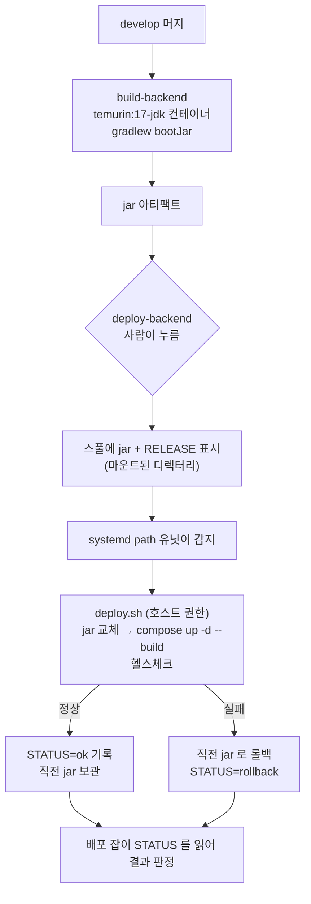

# [Infra] CD 전략 결정 기록 — 무엇을 · 어떻게 · 언제 배포하는가 (S15P21B202-139)

| 항목 | 내용 |
| --- | --- |
| 담당 | 금준영 |
| 기간 | 2026-09-01 |
| Jira | [S15P21B202-139](https://ssafy.atlassian.net/browse/S15P21B202-139) |
| 관련 Epic | [Infra] 개발 환경 (S15P21B202-9) |
| 후속 | -140(빌드 잡) · -141(배포 잡·헬스체크·롤백) · -142(시크릿 경계) · -144(알림) |
| **갱신됨** | **[-284 EC2 한 대에 dev·prod 두 환경](S15P21B202-284-two-env-on-one-ec2.md)** (2026-09-04) — 아래 §0 은 **배포 대상이 한 벌**이라는 가정 위에 있다. 그 가정이 바뀌었다 |

## 목적

지금 백엔드 배포는 **사람 손**이다 — 로컬에서 `./gradlew bootJar` 하고 60MB jar 을 `scp` 하고 `docker compose up -d --build`. 최재현 한 사람만 할 수 있고, 무엇이 언제 올라갔는지 기록이 없다.

EC2 에 러너가 올라왔으므로(-214) 이걸 자동화할 수 있게 됐다. 이 문서는 **구현 전에 방식을 정하는 기록**이고, 코드는 -140·-141 에서 쓴다.

## 0. 결정

> **2026-09-04 갱신.** 아래 결정은 유효하지만 **환경이 한 벌**이라는 전제가 붙어 있다.
> 팀이 `develop`=개발 · `master`=실유저 배포판으로 나누기로 했으므로, 방아쇠(`develop` 수동)와
> 스풀 하나는 [-284](S15P21B202-284-two-env-on-one-ec2.md) 에서 두 벌로 갈라진다.

**2026-09-01 — 스풀 디렉터리 방식 + 사람이 누르는 배포.**

| 항목 | 결정 |
| --- | --- |
| 빌드 | CI 잡이 `eclipse-temurin:17-jdk` 컨테이너에서 `./gradlew bootJar` → jar 을 아티팩트로 |
| 전달 | 배포 잡이 jar 을 **호스트에 마운트된 스풀 디렉터리**에 놓고 완료 표시 파일을 쓴다 |
| 적용 | 호스트의 **systemd path 유닛**이 표시 파일을 보고 `deploy.sh` 실행 — jar 교체 · `compose up -d --build backend` · 헬스체크 |
| 방아쇠 | develop 머지 파이프라인에서 **`when: manual`**(사람이 누른다). 자동 아님 |
| 롤백 | 직전 jar 3개를 보관. 헬스체크 실패 시 **직전 jar 로 자동 복귀** |
| 시크릿 | `.env` 는 **서버에만**(권한 600). CI 는 시크릿을 보지 않는다 |

## 1. 제약 — 이 결정을 만든 조건

| 제약 | 왜 중요한가 |
| --- | --- |
| 러너가 **docker 실행기**다 | 잡은 컨테이너 안에서 돈다. 호스트의 `docker compose` 를 직접 부를 수 없다 |
| 도커 소켓을 마운트하지 않는다 | 소켓 접근은 사실상 호스트 root 다. **백엔드·DB 가 같은 호스트**에 있으므로 잡이 그것들을 만질 수 있게 되는 건 받아들일 수 없다 |
| 나는 **Maintainer 가 아니다** | CI 변수 추가·러너 설정이 안 된다(러너 조회조차 403). 팀장 손이 필요한 설계는 그만큼 늦어진다 |
| 팀원이 이 서버로 **실제 테스트 중**이다 | 백엔드 재시작은 WebSocket 세션을 전부 끊는다. 머지마다 자동 재시작은 남의 테스트를 깨뜨린다 |

## 2. 검토한 방안

| 방안 | 왜 안 했나 |
| --- | --- |
| 도커 소켓 마운트 후 잡이 직접 `compose up` | 가장 간단하지만 잡에게 호스트 root 를 주는 셈이다. 백엔드·DB 와 같은 호스트라 불가 |
| 잡에서 SSH 로 호스트에 접속해 배포 | **보호된 CI 변수**(develop 등 보호 브랜치에서만 노출)에 배포 키를 넣으면 보안 경계가 정확해진다 — **가장 올바른 방식**. 다만 변수 추가가 Maintainer 권한이라 지금은 막혀 있다. 하드닝 경로로 남긴다(§6) |
| 배포 전용 shell 러너를 하나 더 등록 | 태그가 러너 단위(서버 측)라 같은 토큰으로 등록하면 **잡을 골라 보낼 수 없다**. 새 토큰이 필요해 역시 팀장 대기 |
| **스풀 디렉터리 + systemd path 유닛** | 채택. 컨테이너는 파일만 놓고, 호스트가 자기 권한으로 배포한다. 소켓·키·CI 변수가 필요 없다 |

## 3. 흐름

## 4. 왜 자동이 아니라 사람이 누르는가

**팀원이 이 서버로 테스트하는 중이기 때문이다.** 백엔드 재시작은 약 7초지만 그 사이 **WebSocket 세션이 전부 끊긴다** — 방에 들어가 있던 사람은 튕긴다. 하루에 머지가 20건 넘게 일어나는 날도 있었으므로(09-01: 28건) 머지마다 재시작하면 테스트가 불가능하다.

그래서 `when: manual` 이다. 파이프라인 화면에서 ▶ 를 누르는 순간 배포된다 — "언제 올릴지" 만 사람이 정하고, 무엇을 어떻게 올리는지는 자동이다. 또 `changes: backend/**` 로 **백엔드가 바뀐 머지에만** 배포 버튼이 생긴다.

자동으로 바꾸려면 `when: manual` 한 줄을 지우면 된다. 팀이 "테스트 시간대가 아니면 자동" 을 원하면 스케줄 조건도 얹을 수 있다.

## 5. 지금 서버 구성 (2026-09-01 실측, 리포로 반입함)

배포 방식을 정하려면 지금 무엇이 어떻게 돌고 있는지가 먼저다. **서버에만 있던 설정을 `scripts/deploy/server/` 로 반입했다** — 서버를 날렸을 때 재현할 수 있어야 한다.

| 무엇 | 어디 | 리포의 사본 |
| --- | --- | --- |
| 운영 compose (mysql + backend) | `~/metagame/docker-compose.yml` | `scripts/deploy/server/compose.prod.yml` |
| nginx 서버 블록 (TLS·WebSocket 프록시) | `/etc/nginx/sites-available/metagame` | `scripts/deploy/server/nginx/metagame.conf` |
| `$connection_upgrade` map | `/etc/nginx/conf.d/upgrade-map.conf` | `scripts/deploy/server/nginx/upgrade-map.conf` |
| 시크릿 `.env` | `~/metagame/.env` (권한 600) | **반입하지 않는다** — 키 이름만 여기에: `DB_PASSWORD` · `DB_ROOT_PASSWORD` · `JWT_SECRET` |

반입한 두 파일에 **값은 하나도 없다** — compose 는 전부 `${}` 참조이고 nginx 는 인증서 경로만 가리킨다.

주의할 점 둘:

- 리포에 이미 있는 `backend/docker-compose.yml` 은 **로컬 개발용**이다(mysql 만, 비밀번호 하드코딩, 3306 외부 노출). 운영용과 용도가 다르므로 합치지 않는다.
- nginx 의 `proxy_set_header Upgrade/Connection` 네 줄이 WebSocket 을 살린다. 빠뜨리면 **로그인은 되는데 방 입장이 안 된다** — 설정 파일 주석에도 그렇게 적혀 있다.

## 6. 남은 위험과 하드닝 경로

- **스풀 디렉터리는 모든 잡에 마운트된다.** 배포 잡만 develop·manual 로 제한되지만, 원리적으로는 다른 잡도 스풀에 쓸 수 있다. 팀 6명이 쓰는 리포이므로 실질 위험은 *악의*가 아니라 *실수*이고, 그건 develop·manual 조건이 막는다.
  - **2026-09-04 정정: 막지 못한다.** `develop`·`manual` 은 **우리가 쓴 `deploy-backend` 잡에만** 걸린다. MR 파이프라인은 **소스 브랜치의 `.gitlab-ci.yml`** 을 쓰므로, 자기 브랜치에 `/spool` 에 쓰는 잡을 한 줄 추가하면 그 조건들을 통째로 비껴간다. 방아쇠는 `PathExists=…/RELEASE` 파일 하나다. 브랜치에서 못 바꾸는 것은 **러너가 여는 마운트와 러너의 Protected 설정**뿐이라, 러너를 갈라야 한다 — [-252](https://ssafy.atlassian.net/browse/S15P21B202-252). 배포 기록(누가·어떤 sha)을 호스트 로그에 남겨 사후 추적을 가능하게 한다.
- **하드닝 경로**(팀장 손이 나면): 배포 키를 **보호된(protected) + 마스킹된 CI 변수**로 넣고 SSH 로 배포한다. 보호된 변수는 **보호 브랜치 파이프라인에만 노출**되므로 MR 파이프라인은 키를 볼 수 없다 — 경계가 정확해진다. 키는 `authorized_keys` 의 강제 커맨드로 배포 스크립트만 실행하게 묶는다.
- **롤백은 jar 단위**다. DB 마이그레이션이 섞인 배포는 되돌릴 수 없다 — Flyway 같은 것을 넣기 전까지는 스키마를 바꾸는 배포는 사람이 붙어서 한다(☐ Backend 와 합의).

## 7. 이 결정이 다루지 않는 것

- **Mirror 게임 서버 배포**(-162): Unity Linux Dedicated Server 빌드가 선행이다. GameCI 이미지(`unityci/editor:ubuntu-6000.5.4f1-linux-il2cpp-3.2.2`)로 CI 에서 빌드할 수 있음은 확인했다. 배포는 systemd 유닛이므로 같은 스풀 방식을 쓸 수 있다.
  - **2026-09-04 갱신**: 게임 서버는 이미 EC2 에서 돌고 있다 — `metagame.service`, `/opt/metagame/MetaGameServer.x86_64`, UDP 17777, **손으로 올린 상태**. 그리고 `-verifyUrl` 로 백엔드에 묶여 있어 환경을 나누면 함께 갈라야 한다([-284](S15P21B202-284-two-env-on-one-ec2.md) §2).
- **Unity 클라이언트 빌드 배포**(-143): 태그를 달 때만 아티팩트로 만든다. 서버에 올리지 않는다.
- **레지스트리**(-140 의 원래 제목은 "이미지 빌드·레지스트리 푸시"): 레지스트리를 쓰지 않기로 한다. 러너와 배포 대상이 **같은 호스트**라 이미지를 밖으로 보냈다 되받을 이유가 없다. jar 하나만 옮기면 되고, 이미지는 호스트에서 `compose --build` 로 만든다. -140 은 "jar 빌드 잡" 으로 범위를 좁힌다.

## 남은 것 / 후속

- `-140` jar 빌드 잡 (gradle 캐시 포함)
- `-141` 배포 잡 + 호스트 `deploy.sh`(헬스체크·롤백) + systemd path 유닛
- `-142` 시크릿 경계 문서화 — 이 문서 §5 가 초안이다
- `-144` 배포 결과를 MM 카드·아침 점검에 반영
- `-252` 배포 스풀을 공용 러너에서 분리 — **이 문서 §6 이 "실질 위험은 실수"라고 넘긴 부분이 실제로 구멍이었다**
- `-284` EC2 한 대에 dev·prod 두 환경 — 이 문서의 "서버 한 벌" 전제를 갱신한다
