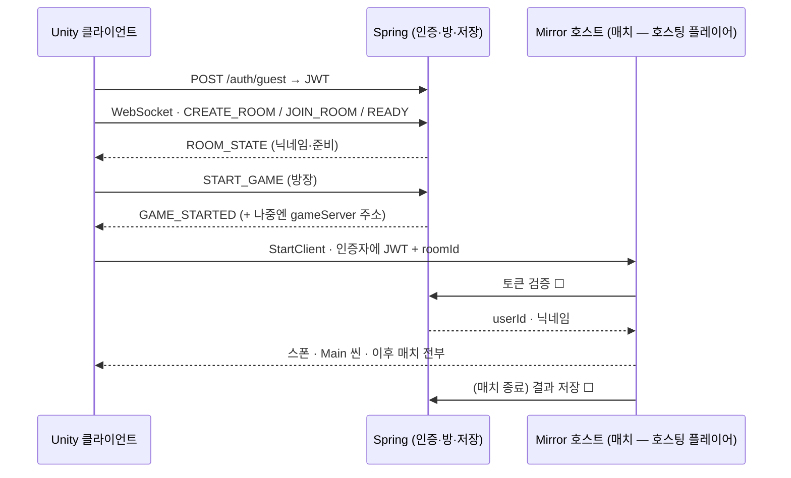
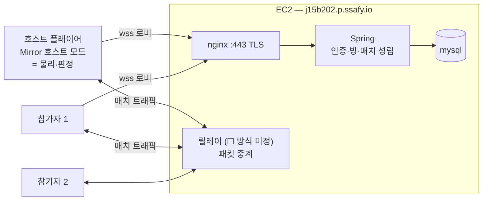

# [Network] 동기화 설계 결정 기록 — Mirror · 호스트 권위 + 서버 경유 (S15P21B202-145)

| 항목 | 내용 |
| --- | --- |
| 담당 | 금준영 |
| 기간 | 2026-08-29 ~ (EC2 반영 08-31 · **구조 정정 09-01**) |
| Jira | [S15P21B202-145](https://ssafy.atlassian.net/browse/S15P21B202-145) |
| 관련 Epic | [Network] 멀티플레이어 및 동기화 (S15P21B202-15) |

## 목적

구현에 들어가기 전에 **어디서 물리를 돌리고, 누가 상태의 정답을 갖는지**를 정한다. 두 갈래를 비교했다 — Spring 이 중계만 하는 자체 WebSocket 방식(서버에 물리 없음)과, Unity 헤드리스 서버가 물리를 돌리는 **Mirror** 방식. 그리고 그 시뮬레이션을 **누가 돌릴지**도 정한다 — 09-01 팀 결정으로 **호스팅 플레이어**가 돌리고 트래픽은 우리 서버를 경유한다(§0 정정, §4).

이 문서는 **계획과 결정**만 담는다. 코드는 없다. `☐` 는 다른 파트의 합의가 필요한 것이다.

## 0. 결정

> **⚠ 2026-09-01 정정 — 아래 08-29·08-31 항목의 "헤드리스 서버" 부분은 팀 결정과 달랐다.**
>
> **팀 결정(팀장·기획 확인, 09-01)**: 매치가 **성립하는 과정까지만** 우리 서버가 담당하고, 그 뒤 **게임 로직과 연산은
> 호스팅을 맡는 플레이어**가 돌린다. 다만 진행 중의 정보 송수신은 **P2P 가 아니라 우리 서버를 최소 한 번 경유**한다.
> (P2P 직결 + 서버는 수신만 하는 안도 언급됐으나 채택하지 않는다.)
>
> 즉 **호스트 권위(리슨 서버) + 서버 릴레이** 다. 아래 §2·§3-1·§3-8·§4 를 그 전제로 고쳤다.
>
> **이 어긋남은 내 잘못이다.** 08-29 에 Mirror 안에서 데디케이티드를 고른 것은 팀 합의가 아니라 내 판단이었는데
> "결정" 으로 적었다. 그 기록이 09-01 에 develop 에 들어갔고(!126), 그때까지 아무도 읽지 않은 상태였다.
> **구현(최재현)은 이 문서를 따랐으므로 실수가 아니다** — 지금 코드에 `StartHost` 가 없고 클라이언트가
> "로비와 같은 호스트(EC2)" 로 접속하는 것은 이 문서의 결과다. 코드 수정 요청은 §5 에 적었다.

**2026-08-29 — Mirror 하이브리드.** Spring 은 **인증 · 방 코드 · 저장 · 매치 진입**(게임 서버 주소 전달)을, **Mirror 헤드리스 서버**는 매치 안의 모든 것(플레이어·부품·운반체·메테오·상호작용 판정)을 담당한다.

근거 한 줄: 이 게임의 핵심(부품 조립·운반·용접)은 **여러 명이 같은 물리 오브젝트를 만지는 것**이다. 물리 권위가 없는 서버로 그걸 하려면 오브젝트 소유권·인계·중재를 손으로 짜게 되고, 그건 netcode 를 직접 만드는 일이다. Photon 은 비용으로 제외(팀 결정).

**2026-08-31 — 서버는 EC2.** 이전 판은 EC2 지급 전이라 "내 PC 가 임시로 서버" 를 전제했다. EC2(`j15b202.p.ssafy.io`)를
받았고 Spring 은 이미 거기서 돌고 있으므로(!105·!107), Mirror 서버도 처음부터 EC2 에 올린다. 내 PC 가 서버를 맡는
단계는 **건너뛴다** — 임시 구성을 만들고 곧 버리는 비용이 없어졌다.

경위: 프로젝트 초기(08-25) 구두로 Mirror 가 언급됐으나 **기록이 남지 않았고**, 08-26 백엔드가 raw WebSocket 을 채택해([backend-guidelines §2](../backend-guidelines.md)) 방·인증·재접속을 구현했다. 그 위에서 인게임 동기화까지 Spring 중계로 가는 계획(이 문서의 이전 판)을 세우다 비교해 보니 부품 상호작용에서 막힌다는 것이 분명해져 다시 정했다. 이 기록이 그 공백을 메운다.

## 1. 두 갈래 비교

| | Spring 중계 (자체 WS) | **Mirror** |
| --- | --- | --- |
| 물리 권위 | 서버에 물리 없음 → 아무도 판정 못 함 | Unity 서버가 **실제 물리를 돌림** → 부품·운반체·메테오 위치가 하나 |
| 플레이어 위치 | 직접 구현 (송신·수신·보간) | `NetworkTransform` |
| 공유 물체 (부품·운반체) | 오브젝트마다 소유자를 정하고 넘기는 로직을 손으로. 두 명이 동시에 밀면 각자 화면이 다르고 서버는 중재 불가 | 서버가 시뮬레이션, 클라이언트는 받아 그림. 상호작용은 `[Command]` 로 요청 |
| 새 메커닉마다 | 메시지 타입 + 송수신 + 소유권 + 보간을 매번 추가 | `SyncVar` / `[ClientRpc]` |
| 재접속 | ✅ 이미 됨(30초 유예·`STATE_SYNC`) | ❌ 기본 제공 없음 — 직접(§3-6) |
| 인증·방 코드·저장 | ✅ 이미 됨 | 없음 — **Spring 이 계속 담당** |
| 호스팅 | 컨테이너 2개 | **호스트 플레이어의 클라이언트**(Mirror 호스트 모드) + Spring · 트래픽은 EC2 릴레이 경유 |
| Steam 출시 | 서버 비용 계속 | FizzySteamworks 전송 → Steam 릴레이 P2P, 매치 서버 비용 0 |
| 비용 | 0 | 0 (MIT) |
| 이미 쓴 공수 | 전부 유효 | -46/-48 의 **인게임 부분**과 -120 이 무효. 로그인·방 코드·MySQL·로비 유예는 유지 |

Spring 중계로 계속 가면 "서로 보인다"까지는 되지만, 그다음 상호작용(-149)부터는 사실상 Mirror 를 JSON 위에 직접 만드는 일이 된다. 네트워크 담당 한 명이 퍼즐 메커닉이 늘어나는 속도에 맞춰 메시지를 추가하는 구조다.

## 2. 역할 분담 — 셋으로 나뉜다 (09-01 정정)

| 누가 | 무엇을 |
| --- | --- |
| **Spring (EC2)** | 인증 · 방 코드 · 참가자 관리 · 저장 · **매치 성립까지**(누가 호스트인지, 언제 시작인지) |
| **호스트 플레이어의 클라이언트** | **매치 안의 모든 로직과 연산** — 물리, 부품·운반체·메테오, 상호작용 판정. Mirror 의 호스트 모드(서버+클라이언트 한 프로세스) |
| **EC2 릴레이** | 호스트와 참가자 사이의 **패킷 중계**. P2P 직결을 쓰지 않는다 — NAT 통과 문제를 없애고 트래픽이 우리 서버를 지난다 |

**Mirror 관점에서 달라지는 것은 적다.** 호스트 모드는 서버 코드를 그대로 재사용하므로 `[Command]`·`SyncVar`·권위
로직은 데디케이티드와 동일하다. 바뀌는 것은 **누가 서버를 켜는가**(헤드리스 프로세스 → 호스트 클라이언트)와
**어떻게 연결되는가**(직접 접속 → 릴레이 경유)뿐이다. 그래서 이미 머지된 -146·-147·-148 은 거의 그대로 산다.

### 2-1. 원래 표 (Spring vs Mirror 경계)

| 남는다 (Spring) | 맡는다 (Mirror) | 빠진다 |
| --- | --- | --- |
| 게스트 로그인·JWT (-40) | 플레이어 스폰·이동·조작 | `PLAYER_MOVE` / `PLAYER_MOVED` 중계 (-120) |
| 방 코드·준비·시작 (-46, -76) | 부품·운반체·메테오 스폰과 물리 | `GameState` 의 위치·`STATE_SYNC` 의 인게임 부분 |
| 로비 단계 재접속 유예 (-48) | 상호작용 판정(잡기·클램프·용접·탑승) | -54 "GameState 필드·게임플레이 메시지" 의 인게임 몫 |
| 닉네임 (-119) | 기절·소생·클리어 판정 → 결과를 Spring 에 저장 | -128 (클라이언트 위치 동기화 — -146~-148 과 중복) |
| MySQL 영구 데이터 | 매치 중 재접속 30초 유예 | |

**1차(이번·다음 스프린트)에 Spring 코드 변경은 최소**다: 게임 서버 주소는 로비에 입력한 호스트를 그대로 쓰므로 `GAME_STARTED` 를 바꿀 필요가 없고, 필요한 것은 **토큰 검증 엔드포인트 하나** ☐ (§3-5). 결과 저장 API 는 클리어 판정을 만들 때.

## 3. 매치 안 설계

### 3-1. 권위 — 호스트 권위 물리, 조작은 입력 전송

**호스트 플레이어의 클라이언트**(Mirror 호스트 모드)가 물리를 돌린다. 아래 내용은 데디케이티드일 때와 같다 —
Mirror 에서 호스트는 서버 역할을 그대로 수행하기 때문이다. 단 **호스트 자신은 왕복 지연이 0** 이고
다른 참가자는 릴레이 왕복이 붙는다(§3-8). 원문의 "헤드리스 서버" 는 "호스트" 로 읽으면 된다. 플레이어 조작은 **입력(`InputFrame`)을 `[Command]` 로 보내고 서버의 `PlayerRig` 가 힘을 가한다**. 클라이언트의 내 캐릭터도 서버가 보낸 위치를 그린다(`NetworkTransform`, 서버→클라이언트). 클라이언트 예측은 하지 않는다.

- 왜: 부품·운반체와의 접촉 결과가 하나여야 한다. 내 캐릭터만 클라이언트 권위로 두면 "내 화면의 나"와 "서버의 나"가 부품을 미는 순간 갈라진다.
- 감수: 조작에 왕복 지연이 붙는다. LAN 5~20ms, EC2 서울 +20ms — 협동 퍼즐에서 체감 안 될 것으로 본다. **거슬리면 내 플레이어만 `ClientToServer`(클라이언트 권위)로 바꾸는 것**을 결정 항목으로 남긴다(-147, -151 실측 후).
- 입력 전송률: 매 물리 틱(100Hz)이 아니라 **변화 시 + 최소 20Hz**. 서버는 마지막 입력을 보관해 매 `FixedUpdate` 에 적용한다.
- 카메라(`OrbitCamera`)는 로컬에 남고, 조준 방향은 입력에 포함해 보낸다.

### 3-2. 네트워크 오브젝트 구성 — 얇은 루트 프리팹 + 양쪽에서 코드 생성

`PlayerRig.Create` · `RagdollBuilder.Build` · `LevelBuilder` · `Prim.*` 는 전부 **프리팹 없이 런타임에 GameObject 를 조립**한다. Mirror 는 네트워크로 스폰하는 오브젝트가 **등록된 프리팹**이어야 한다. 그래서:

| 구분 | 어떻게 |
| --- | --- |
| 플레이어 | `NetworkIdentity` + `NetworkTransform` 만 가진 **얇은 루트 프리팹**을 서버가 스폰. 몸(래그돌)은 서버·클라이언트가 **같은 코드로 그 아래에 생성**. 서버는 물리 래그돌, 클라이언트는 표현용 |
| 정적 지형 (`LevelBuilder`) | 네트워크에 태우지 않는다. 이미 고정 시드(20260825)라 양쪽이 같은 것을 만든다 |
| 동적 오브젝트 (부품·운반체·메테오) | 얇은 루트 프리팹 + 서버 스폰. 물리는 서버, 클라이언트는 `NetworkTransform` 으로 받음. `TickCount` 시드 문제(-152)는 서버가 위치를 정하므로 사라진다 |
| 레이어 | 클라이언트의 원격/내 표현체가 로컬 물리와 충돌하지 않게 `GameLayers` 에 표현용 레이어 추가 ☐ (Puzzle 파트 -57 체계 위에) |

### 3-3. 전송 주기와 보간

Mirror 문서 기준: 동기화 간격은 `NetworkManager` 의 **Send Rate**(예: 10 = 0.1초), `NetworkTransform` 은 **Reliable / Unreliable** 두 종류, 보간은 **스냅샷 보간**이고 버퍼 시간 = 전송 간격 × 배수(3배 권장), 방향 기본값은 서버→클라이언트.

- 시작값: **Send Rate 20 · 버퍼 3배 · 전부 Reliable**(문서 권장). 플레이어를 Unreliable 로 바꿀지는 -151 실측 후.
- 래그돌: **Hips(루트)만 동기화**. 팔다리는 클라이언트 로컬(키네마틱 Hips 를 따라가는 조인트, 또는 rest pose) — -148 에서 둘 중 하나를 고른다. 본 전체 동기화는 트래픽 대비 얻는 게 없다.
- 순간이동(리스폰·재접속)은 보간하지 않고 스냅.
- `NetworkRigidbody` 는 Mirror 에서 **Experimental** 표기 — 플레이어에는 쓰지 않는다. 부품·운반체에 쓸지는 -152 에서 판단하고 기록.

### 3-4. 상호작용 — 요청은 클라이언트, 판정은 서버

`Interactor` · `TractorBeamController` · `PartClamp` · `WeldPoint` · `TransportVehicle` 탑승의 진입점이 클라이언트에서는 **`[Command]` 요청만** 보내고, 판정과 실행은 서버에서만 일어난다. 결과 상태(`PartState`, 누가 들고 있나, 탑승자)는 `SyncVar` 로 모두에게 같다. 두 명이 동시에 잡으면 서버가 하나만 허용한다. **Epic -15 의 "대표 상호작용 1개"는 트랙터 빔으로 부품 들기**로 충족한다(-149).

이 이슈부터 Puzzle 파트 코드에 `[Server]` / `[Command]` / `[ClientRpc]` 가 들어간다. 패턴 한 장을 -149 전에 이 문서에 추가해 김주성과 맞춘다.

### 3-5. 인증 — Spring 의 JWT 를 게임 서버가 Spring 에 물어 확인

커스텀 `NetworkAuthenticator`(Mirror 는 Basic·Device 인증자를 기본 제공하고 커스텀을 허용한다): 클라이언트가 **JWT + roomId** 를 보내면 서버가 Spring 에 토큰을 검증해 userId·닉네임을 확정한다. 다른 방이면 거절. 게임 서버는 부팅 인자로 roomId 를 받아 **1 서버 = 1 매치**로 시작한다(방이 여럿이면 프로세스를 늘린다 — 지금은 범위 밖).

- ☐ Backend: 토큰 검증 엔드포인트(예: 토큰을 주면 userId·nickname 을 돌려주는 REST 하나).
- 버린 대안: 게임 서버가 시크릿을 갖고 직접 검증 — 시크릿이 두 곳에 놓인다.

### 3-6. 재접속 — 30초 유예를 Unity 서버에 재구현

Mirror 는 연결이 끊기면 플레이어 오브젝트를 **바로 지운다**. 팀 규칙(backend-guidelines §5·§6)은 30초 유예 · 복귀 시 그 자리 · 초과 시 제외, 재입장은 기절 상태다. 서버에서 끊긴 오브젝트를 30초 유지하고, 같은 userId(§3-5 인증자가 확정)로 돌아오면 **기존 오브젝트에 권한을 재부여**(`ReplacePlayerForConnection` 패턴), 초과하면 제거·이후 재입장은 DOWNED 스폰(-150). Spring 의 로비 단계 유예(-48)는 그대로.

### 3-7. 진행 판정과 저장

기절·소생·전원 기절·스테이지 클리어 판정은 **매치 서버(Unity)** 가 한다 — backend-guidelines §5-3 "판정은 서버 권위로" 의 "서버"가 Mirror 서버로 바뀐다. 영구 진행도(§5-2)는 매치 서버가 Spring REST 로 저장을 요청한다 ☐ Backend(클리어 판정을 만들 때).

### 3-8. 전송 계층

**⚠ 09-01 정정 — 릴레이가 필요하다.** 호스트가 플레이어 PC 이므로 참가자가 호스트에 **직접** 붙으려면
포트포워딩이나 NAT 통과가 필요하다. 교육장 공용 Wi-Fi 에서는 거의 확실히 막힌다. 팀 결정대로 **우리 서버를
최소 한 번 경유**하려면 EC2 가 릴레이 역할을 해야 하는데, **Mirror 는 릴레이를 기본 제공하지 않는다**
(KCP·Telepathy·SimpleWeb 모두 "서버가 듣고 클라이언트가 붙는" 구조다). 선택지 ☐ 결정 필요:

| 방안 | 필요한 것 | 비고 |
| --- | --- | --- |
| **커뮤니티 릴레이**(Light Reflective Mirror 계열) | EC2 에 릴레이 서버 프로세스 + 클라이언트 전송 교체 | Mirror 용으로 만들어진 것. **Unity 6000.5 동작 확인이 선행** |
| **상용 릴레이**(Edgegap 등) | 계정·요금 확인 | 비용 때문에 Photon 을 뺐던 것과 같은 저울 |
| **Steam 릴레이**(FizzySteamworks) | Steam 출시 시 | 출시 후에는 이것이 곧 "P2P 아님" 을 만족한다. 개발 중엔 못 쓴다 |
| **자체 릴레이** | UDP 포워더를 직접 작성 | 가장 통제 가능하지만 우리가 netcode 를 또 만드는 셈 |

**단계적으로 가는 안**(권장): 개발·교육장 시연은 **같은 LAN 직접 접속**(릴레이 없이 동작, 지금 코드에 가까움)으로
먼저 굴리고, 인터넷 플레이가 필요해지는 시점에 위 표에서 하나를 고른다. 그러면 릴레이 선택이 시연 일정을 막지 않는다.

전송 자체는 **KCP(UDP)** 기본. 직접 접속일 때 포트는 **17777**(7777 은 기본값이라 지급 지침이 금지 — §4-3).
WebGL 은 계획에 없으므로(목표는 Steam) `SimpleWebTransport` 는 원래 불필요했지만, **EC2 에서 UDP 를 열 수 없을 때의**
**예비 경로**로는 의미가 있다(wss/443, §4-3). Steam 출시 시 **FizzySteamworks 로 전송만 교체**하면 Steam 릴레이 P2P 가
되어 매치 서버 비용이 0 이 된다 — 코드 구조는 그대로.

### 3-8-1. 릴레이 방식 결정 — **Edgegap** (2026-09-02 조사, -264)

§3-8 이 "☐ 결정 필요" 로 남긴 자리에 대한 답이다.

| 후보 | 판정 |
| --- | --- |
| Light Reflective Mirror | ❌ **2022-09-05 보관(archived)**. 4년째 유지보수 없음, Mirror 96 대응 없음 |
| **Edgegap 릴레이** | ✅ **Mirror 96.11.2 에 이미 들어 있다** — `Transports/Edgegap/EdgegapRelay/`. 새로 받을 것이 없다 |
| Epic Online Services | 예비안. Mirror 공식 문서가 무료 릴레이로 소개 |
| Steam(FizzySteamworks) | 출시 후. 그때 전송만 교체하면 매치 서버 비용 0 |

**왜 Edgegap 인가.** `EdgegapKcpTransport : KcpTransport` 다 — 지금 쓰는 전송의 **자식 클래스**라
컴포넌트만 갈아 끼우면 된다. Edgegap 문서가 *"릴레이는 권위 게임 서버가 아니다 — 연산을 포함하지
않는다"* 고 못박는데, 물리를 방장이 돌리는 우리 구조에 정확히 맞는다.

**무료 한도 — 계정에서 직접 확인할 것.** 가격 페이지는 *"Up to 50 CCU · 160 GB Egress"* 라고
안내하는데, **실제 대시보드의 릴레이 탭에는 `0/20` 으로 보였다**(2026-09-02 실측). 어느 쪽이 맞는지는
계정 화면이 정답이다. 초과 시 CCU 당 $0.14 · GB 당 $0.10.

| 한도 | 4인 기준 동시 팀 수 |
| --- | --- |
| 20 CCU | **5팀** |
| 50 CCU | 12팀 |

**둘 중 어느 쪽이어도 시연에는 충분하다.** 그리고 같은 네트워크에서 직접 접속으로 붙는 사람은
릴레이를 지나지 않으므로 이 한도를 쓰지 않는다. 한도가 모자라면 EOS(에픽 무료 릴레이)로 갈아탄다.

**세션 만들기** (`https://api.edgegap.com`, 헤더 `Authorization: Token <API_TOKEN>`)

| 무엇 | 어떻게 |
| --- | --- |
| 만들기 | `POST /v1/relays/sessions` · 본문 `{"users":[{"ip":"1.1.1.1"},{"ip":"2.2.2.2"}]}` |
| 응답 | `session_id`(문자열) · `status:"Initializing"` · `ready:false` |
| 준비 확인 | `GET /v1/relays/sessions/{session_id}` 를 `ready:true` 가 될 때까지 |
| 끝내기 | `DELETE /v1/relays/sessions/{session_id}` |

**참가자의 공인 IP 가 필요하다.** Spring 은 로비 WebSocket 으로 각자의 주소를 이미 보고 있으므로
그것을 모아 쓴다. 이것이 릴레이 세션을 **Spring 이** 만들어야 하는 이유다 — 클라이언트는 남의 IP 를 모른다.

**응답을 전송 설정에 옮기는 표** (`ready:true` 인 응답 기준)

| `EdgegapKcpTransport` 필드 | API 응답 |
| --- | --- |
| `relayAddress` | `relay.ip` |
| `relayGameServerPort` | `relay.ports.server.port` |
| `relayGameClientPort` | `relay.ports.client.port` |
| `sessionId` (uint) | `authorization_token` — **방 전원이 같은 값** |
| `userId` (uint) | `session_users[i].authorization_token` — **사람마다 다른 값** |

주의: Edgegap 의 `session_id` 는 **문자열**이고 전송의 `sessionId` 는 **uint** 다. 둘은 다른 것이다 —
전송에 넣는 값은 세션 단위 `authorization_token` 이다. 헷갈리면 조용히 접속에 실패한다.

**GAME_STARTED 가 실어 나른다.** -263 이 만든 `hostAddress` 자리를 그대로 쓰되, 릴레이일 때는
주소 대신 위 다섯 값을 싣는다. 사람마다 `userId` 가 다르므로 **방송이 아니라 각자에게 따로** 보내야 한다.

**직접 접속 경로를 남긴다.** 릴레이가 죽어도 같은 네트워크 시연은 굴러가야 한다(-263 의 랜 직접 접속).

**모두 같은 공유기 뒤면 릴레이를 아예 만들지 않는다.** Spring 이 보는 공인 IP 가 하나뿐이면
같은 네트워크라는 뜻이고, 그때는 사설 주소로 서로 바로 닿는다. 굳이 태우면 지연만 늘고
**릴레이 동시접속 한도(과금 기준)를 쓴다** — 교육장처럼 다 같이 있는 자리가 정확히 이 경우다.
같은 공인 IP 인데도 공유기가 기기끼리의 통신을 막아 두면(AP isolation) 못 붙는데,
그때는 §4-3 대로 핫스팟으로 우회한다.

## 4. 어디서 도는가 — 호스팅 플레이어 + EC2 경유 (09-01 정정)

### 4-1. 구성

로비·방까지는 모두가 **HTTPS/wss 로 Spring**. 매치가 시작되면 **호스트 플레이어의 클라이언트가 서버 역할**을 하고,
참가자들의 매치 트래픽은 **EC2 릴레이를 경유**해 호스트에 닿는다. P2P 직결은 쓰지 않는다(팀 결정).

**릴레이 방식은 아직 미정이다(☐ §3-8).** 그것이 정해지기 전까지는 **같은 LAN 직접 접속**으로 개발·시연한다 —
그 경우 참가자가 호스트의 사설 IP 로 바로 붙고 릴레이는 관여하지 않는다.

### 4-2. EC2 현황 (2026-08-31 실측 — SSH 로 직접 확인)

호스트가 시뮬레이션을 맡더라도 EC2 는 여전히 로비·인증·저장과 **릴레이**를 담당한다. 실측값은 그대로 유효하다.

| 항목 | 상태 |
| --- | --- |
| 주소 | `j15b202.p.ssafy.io` · Ubuntu (`7.0.0-1011-aws`) · x86_64 |
| 사양 | RAM 15 GiB (사용 1.3 GiB) · 디스크 309 GB (사용 5 GB) · **스왑 0 B** |
| 방화벽 | UFW **active**, 기본 deny(incoming). 허용은 **22 · 80/tcp · 443/tcp** 뿐 |
| Spring | docker 컨테이너, **`127.0.0.1:8080` 에만** 바인딩. mysql 은 호스트 게시 없음 |
| TLS | nginx + certbot 타이머 동작. `docker` 서비스 `enabled` = 재부팅 자동 기동 |
| 확인된 엔드포인트 | `POST /auth/guest` → **200** · `/ws/game` 토큰 없이 → **401** |
| **릴레이 포트** | 아직 없다. 릴레이 방식이 정해지면 UFW 에 그 포트를 연다 |

### 4-3. 포트 — **17777/UDP** (직접 접속용, 2026-09-01 확정)

- **7777 을 쓰지 않는다.** Mirror·Unity 의 기본값이고, EC2 지급 안내가 기본 포트 변경을 요구한다.
- **17777/UDP** 로 정했다(Infra 결정). 고른 이유: ① 1024 이상 ② 리눅스 임시 포트 범위(32768–60999) **밖**
  ③ 잘 알려진 서비스와 겹치지 않음 ④ 7777 과 연상돼 기억하기 쉽다.
- **호스트 권위로 바뀌면서 이 포트가 열리는 곳도 바뀐다** — EC2 가 아니라 **호스트 플레이어의 PC**다.
  같은 LAN 이면 호스트 PC 방화벽에서 인바운드 UDP 17777 을 허용하면 되고, 인터넷 플레이는 릴레이가 필요하다.
- **두 곳을 같이** 바꾼다: ① `KcpTransport` 의 Port(!112 가 들고 있는 NetworkManager 설정) ② 클라이언트 기본값
  (`NetworkSession`). 릴레이를 쓰게 되면 그 전송의 주소·포트가 여기에 대신 들어간다.

### 4-4. 빌드 — 서버 빌드가 필요 없어졌다

호스트가 플레이어의 클라이언트이므로 **별도의 Linux Dedicated Server 빌드가 필요하지 않다.** 클라이언트 빌드
하나가 호스트도 되고 참가자도 된다(Mirror 호스트 모드). 이것이 데디케이티드 대비 가장 큰 실무적 차이다.

Unity CI 는 그래도 값이 있다 — 다만 **명분이 바뀐다**:

| 쓸모 | 필요한가 |
| --- | --- |
| MR 마다 **컴파일 검사** | 그대로 필요(지금 없다) |
| **Windows 클라이언트 빌드** 아티팩트(-143) | 그대로 필요 |
| ~~Linux 데디케이티드 서버 빌드~~ | **불필요** — 호스트 권위로 바뀌어 서버 실행 파일이 없다 |
| 릴레이 프로세스 빌드 | 릴레이 방식이 Mirror 기반이면 필요할 수 있다(☐ §3-8) |

GameCI 이미지에 우리 버전(`ubuntu-6000.5.4f1-*`)이 있는 것은 확인해 뒀다. 첫 에셋 임포트가 오래 걸리므로
`Library/` 캐시는 여전히 필수다.

### 4-5. 운영 규칙

- **상시 켜 둘 게임 서버 프로세스가 없다.** 호스트가 방을 만들면 그 사람의 클라이언트가 서버가 된다.
- **호스트가 나가면 매치가 끝난다.** 호스트 이관(migration)은 Mirror 로 간단하지 않다 — 범위 밖으로 두고,
  "방장이 나가면 매치 종료" 를 기획에 명시해야 한다(☐ Plan).
- EC2 쪽 운영은 로비(Spring)와 릴레이뿐이다. 릴레이가 죽으면 매치가 안 되므로 그때는 systemd 로 상시 기동한다.
- 서버 코드가 바뀌면 클라이언트를 다시 배포해야 한다 — **호스트와 참가자의 빌드 버전이 같아야 한다**(Mirror 는
  다른 버전 간 호환을 보장하지 않는다). 빌드 배포 방식은 -143.

### 4-6. 내 PC 의 역할 — 서버 아님

이전 판에서 내 PC 가 서버였다. 지금은 **GitLab 러너의 백업**일 뿐이다. 08-28 러너 중단 1시간과 08-31 MAX_PATH
파이프라인 전멸이 같은 원인 — 팀 작업이 내 PC 한 대에 묶이는 구조 — 이었고, 그것을 없애는 것이 EC2 이전의 목적이었다.

## 5. 구현 순서

`Network/` 파일을 이어서 고치므로 **스택 MR**([mr-flow.md](../mr-flow.md) §3). 아래부터 머지. 점수는 1·2·3·5.

| 순서 | 이슈 | 내용 | 점수 | 남의 파일 |
| --- | --- | --- | --- | --- |
| 0 | -145 | 이 기록 (이번 스프린트) | 2 | — |
| 1 | **-160** | Mirror 도입·뼈대 — 패키지(6000.5 컴파일 확인) · NetworkManager(Lobby 오프라인 / Main 온라인) · KCP · ~~Dedicated Server 빌드 프로필~~(09-01 정정: 서버 빌드 불필요) · 서버 1 + 클라 2 접속 | 5 | `LobbyBootstrap`(-125) |
| 2 | **-161** | 매치 진입 — `GAME_STARTED` → `StartClient` · JWT 인증자 · roomId 검사 | 3 | ☐ Backend 검증 API |
| 3 | **-162** | **호스트 모드 전환** — 방장 클라이언트가 `StartHost`, 주소를 `GAME_STARTED` 로 전달, 참가자는 그 주소로 `StartClient`. 같은 LAN 첫 접속 실측 | 3 | ☐ Backend 주소 전달 |
| 3b | **신설 필요** | **릴레이 도입** — §3-8 표에서 방식 선택 후 EC2 에 세우고 전송 교체 | ? | ☐ 방식 결정 |
| 4 | **-146** | 플레이어 네트워크 스폰 — 얇은 루트 + 양쪽 래그돌, 접속·이탈 | 3 | `GameLayers`(김주성) |
| 5 | **-147** | 조작 서버 권위화 — 입력 `[Command]`, 서버 `PlayerRig` | 5 | `PlayerRig`(Character 파트와 공유) |
| 6 | **-148** | 원격 표현 튜닝 — Send Rate·버퍼, Hips 동기화 | 3 | — |
| 7 | **-152** | 월드 오브젝트 네트워크 스폰 — 부품·운반체·메테오 서버 스폰 | 3 | `LevelBuilder`·`TractorBeamController`·`MeteorSpawner`(김주성) |
| 8 | **-149** | 상호작용 서버 권위화 — 트랙터 빔으로 부품 들기 = Epic 완료 기준 | 5 | `Interaction/`·`Parts/`(김주성) |
| 9 | **-150** | 재접속 30초 유예 | 5 | — |
| 10 | **-151** | 실측 기록 | 2 | — |

합계 39점(+릴레이 미정) — 약 두 스프린트.

**09-01 코드 수정 요청(최재현)** — 지금 코드는 이 문서의 이전 판(데디케이티드)을 따랐다:

1. `MirrorLaunchArgs` 의 `-server` 경로는 **검증용으로 남기고**, 실제 매치는 방장 클라이언트가 `StartHost()` 로 시작
2. `LobbyBootstrap` 이 지금은 "로비와 같은 호스트"(EC2)로 붙는다 — **`GAME_STARTED` 가 실어 주는 호스트 주소**를 쓰도록
3. Spring 은 방장이 누구인지 알고 있으므로 `GAME_STARTED` 에 **호스트 주소(또는 릴레이 세션 id)** 를 넣어 준다 ☐ Backend
4. `MatchAuthenticator` 는 그대로 — 호스트가 Spring 에 토큰을 물어보는 흐름은 동일하다

-146·-147·-148 은 손댈 필요가 없다. Mirror 호스트 모드는 서버 코드를 그대로 재사용한다. **선행**: -125(로비 씬)·-126(주소 입력) — **둘 다 머지됨(2026-08-31)**. -160 도 !112 로 올라와 있다. 남의 파일을 건드리는 이슈(4·5·7·8)는 MR 전에 그 파트와 설계를 맞춘다.

## 5-1. 원격 표현 수치 (-148, 2026-09-01)

시작값이다. LAN 실측(-151)에서 조정한다.

| 값 | 어디 | 정한 값 | 왜 |
| --- | --- | --- | --- |
| `sendRate` | NetworkManager | **20** | 초당 20번. 100Hz 물리를 그대로 보내면 5배 낭비다. 사람 움직임은 20Hz 로 충분하고, 사이는 스냅샷 보간이 메운다 |
| `syncInterval` | NetworkTransform | **0** (= sendRate 그대로) | 플레이어는 가장 자주 보내야 하는 대상이다. 부품은 -152 에서 따로 늦춘다 |
| `bufferTimeMultiplier` | NetworkManager | **3** (기본 2) | 받은 것을 바로 그리지 않고 3 × 전송간격(150ms) 만큼 뒤처져 그린다. 짧으면 한 패킷만 늦어도 끊기고, 길면 지연이 그만큼 늘어난다. 인터넷 경유(EC2)라 기본값보다 한 칸 넉넉히 잡았다 |
| `dynamicAdjustment` | NetworkManager | **켬**(기본) | 위 3은 하한이고, 실제 흔들림(jitter)을 재서 Mirror 가 알아서 늘린다. 값을 크게 잡아 두는 것보다 이쪽이 낫다 |
| `onlySyncOnChange` | NetworkTransform | **켬**(기본) | 가만히 있으면 안 보낸다 |
| 관절 용수철 | `RemoteAvatar` | spring **120** / damper **12** | 팔다리를 붙드는 힘. 0이면 축 늘어진 시체가 되고, `PlayerRig` 가 무기를 들 때 쓰는 220 이면 마네킹처럼 뻣뻣하다 |
| 스냅 거리 | `RemoteAvatar` | **3 m** | 이만큼 한 번에 벌어지면 보간하지 않고 그 자리로 옮긴다. 리스폰·재접속을 이어 그리면 몸이 맵을 가로질러 날아간다 |

**래그돌을 어떻게 보여 줄지**는 두 안 중 "골반만 동기화 + 팔다리는 로컬 조인트"를
택했다. 관절 11개를 전부 보내면 사람 수 × 관절 수만큼 트래픽이 늘고, 팔다리가
정확히 어디 있는지는 게임 결과에 영향을 주지 않는다. 다만 `PlayerRig` 의 조종
로직이 꺼진 원격 몸에서는 조인트 드라이브가 기본값(용수철 0)이라 그대로 두면
늘어진다 — 그래서 `RemoteAvatar` 가 붙을 때 용수철을 한 번 걸어 준다.

`rest pose` 안(전부 키네마틱으로 고정 자세 유지)은 버렸다. 더 싸지만 움직일 때
몸이 통째로 미끄러지는 그림이 된다. 조인트 안은 물리를 조금 쓰는 대신 저절로
흔들린다.

## 5-1. 원격 표현 수치 (-148, 2026-09-01)

시작값이다. LAN 실측(-151)에서 조정한다.

| 값 | 어디 | 정한 값 | 왜 |
| --- | --- | --- | --- |
| `sendRate` | NetworkManager | **20** | 초당 20번. 100Hz 물리를 그대로 보내면 5배 낭비다. 사람 움직임은 20Hz 로 충분하고, 사이는 스냅샷 보간이 메운다 |
| `syncInterval` | NetworkTransform | **0** (= sendRate 그대로) | 플레이어는 가장 자주 보내야 하는 대상이다. 부품은 -152 에서 따로 늦춘다 |
| `bufferTimeMultiplier` | NetworkManager | **3** (기본 2) | 받은 것을 바로 그리지 않고 3 × 전송간격(150ms) 만큼 뒤처져 그린다. 짧으면 한 패킷만 늦어도 끊기고, 길면 지연이 그만큼 늘어난다. 인터넷 경유(EC2)라 기본값보다 한 칸 넉넉히 잡았다 |
| `dynamicAdjustment` | NetworkManager | **켬**(기본) | 위 3은 하한이고, 실제 흔들림(jitter)을 재서 Mirror 가 알아서 늘린다. 값을 크게 잡아 두는 것보다 이쪽이 낫다 |
| `onlySyncOnChange` | NetworkTransform | **켬**(기본) | 가만히 있으면 안 보낸다 |
| 관절 용수철 | `RemoteAvatar` | spring **120** / damper **12** | 팔다리를 붙드는 힘. 0이면 축 늘어진 시체가 되고, `PlayerRig` 가 무기를 들 때 쓰는 220 이면 마네킹처럼 뻣뻣하다 |
| 스냅 거리 | `RemoteAvatar` | **3 m** | 이만큼 한 번에 벌어지면 보간하지 않고 그 자리로 옮긴다. 리스폰·재접속을 이어 그리면 몸이 맵을 가로질러 날아간다 |

**래그돌을 어떻게 보여 줄지**는 두 안 중 "골반만 동기화 + 팔다리는 로컬 조인트"를
택했다. 관절 11개를 전부 보내면 사람 수 × 관절 수만큼 트래픽이 늘고, 팔다리가
정확히 어디 있는지는 게임 결과에 영향을 주지 않는다. 다만 `PlayerRig` 의 조종
로직이 꺼진 원격 몸에서는 조인트 드라이브가 기본값(용수철 0)이라 그대로 두면
늘어진다 — 그래서 `RemoteAvatar` 가 붙을 때 용수철을 한 번 걸어 준다.

`rest pose` 안(전부 키네마틱으로 고정 자세 유지)은 버렸다. 더 싸지만 움직일 때
몸이 통째로 미끄러지는 그림이 된다. 조인트 안은 물리를 조금 쓰는 대신 저절로
흔들린다.

## 5-2. 월드 오브젝트를 어떻게 맞추나 (-152, 2026-09-01)

| 대상 | 어떻게 | 왜 |
| --- | --- | --- |
| 지형 (`LevelBuilder`) | 네트워크에 안 태운다 | 이미 고정 시드(20260825)라 양쪽이 같은 코드로 같은 것을 만든다 |
| **부품 · 운반체** | 서버가 자세를 내려보낸다 (`WorldSync`) | 씬에 배치된 오브젝트다. 아래 참조 |
| **메테오** | **그대로 둔다** | 씬의 `MeteorSpawner` 가 `_seed 20260827` 고정이고 런타임에 덮이지 않는다 — 생성 시점과 낙하 지점이 이미 모든 PC 에서 같다. 피해 판정은 서버에서만 일어난다(클라이언트의 몸은 키네마틱이고 충돌을 잡지 않는다). 서버 스폰으로 바꾸면 프리팹·스폰·소멸 중계가 새로 필요한데, 지금 얻는 것은 낙하 중 미세한 그림 차이뿐이다 |

**`NetworkRigidbodyReliable` 판단** — `-145 §7` 에 "Experimental 표기라 플레이어엔 안 쓴다" 고 적었는데, Mirror 96.11.2 에서는 `Mirror` 네임스페이스의 정식 컴포넌트다(`Components/NetworkRigidbody/`). Experimental 딱지가 사라졌다. 다만 이번에는 쓰지 않았다 — 아래 이유로 오브젝트마다 `NetworkIdentity` 를 달 수 없었기 때문이다.

**왜 오브젝트마다 `NetworkIdentity` 를 달지 않았나.** 부품과 운반체는 코드가 만드는 것이 아니라 **씬에 배치돼 있다**(부품 4 · 운반체 2). 씬에 놓인 오브젝트를 Mirror 가 서버·클라이언트 사이에서 짝지으려면 `sceneId` 가 필요한데, 그 값은 **Unity 에디터가 씬을 저장할 때 부여한다**. 씬 파일을 손으로 고치는 방법으로는 안전하게 만들 수 없다.

그래서 중계용 오브젝트 하나(`PF_WorldSync`)를 서버가 띄우고, 그것이 씬 오브젝트들의 자세를 20Hz 로 실어 나른다. 양쪽이 같은 씬을 열고 있으므로 같은 규칙으로 줄을 세우면(이름 → 처음 위치) 번호만으로 짝지을 수 있다.

- **장점**: 씬 파일을 건드리지 않는다 — 다른 파트와 씬 충돌이 나지 않는다. 스폰 프리팹 목록도 코드로 등록해 로비 씬을 안 건드린다.
- **단점**: 오브젝트마다 소유권·권한을 따로 줄 수 없다. `-149` 에서 "누가 이 부품을 잡았나" 를 다룰 때 번호 기준으로 얹거나, 그때 에디터로 `NetworkIdentity` 를 붙이는 쪽으로 옮겨야 한다.
- **되돌리는 법**: 에디터에서 씬 오브젝트에 `NetworkIdentity` + `NetworkRigidbodyReliable` 을 붙이고 `WorldSync` 를 지우면 된다. 그때가 정석이다.

## 6. 검증 계획 (-151 의 기준)

| 무엇 | 어떻게 | 기대 |
| --- | --- | --- |
| 혼자 | 한 PC 에서 **호스트로 시작한 빌드** + 클라 빌드(또는 에디터) | 두 창에서 서로 보이고 부품을 한쪽이 들면 다른 쪽에도 들린다 |
| 2 PC | **EC2 서버 + 팀원 PC 2대**(같은 Wi-Fi 여도 되고 아니어도 된다 — 인터넷 경유) | 조작 체감 지연 · RTT · 서버/클라 KB/s · Send Rate 후보 비교. **AP isolation 문제가 사라졌다** |
| 재접속 | 한쪽 Wi-Fi 끄고 20초 뒤 켬 | 30초 안이라 같은 자리로 복귀, 상대 화면엔 정지 표시 → 재개 |
| 호스트 부하 | 4인 접속, 래그돌 4 + 부품 전부 | **호스트 PC** 의 CPU·프레임 — 호스트는 게임도 같이 그리므로 데디케이티드보다 불리하다. 여기서 드러난다 |

## 7. 위험과 대비

| 위험 | 대비 |
| --- | --- |
| ~~Mirror 의 Unity 6000.5 지원~~ | **해소(2026-08-31)** — !112 에서 6000.5.4f1 컴파일이 확인됐다 |
| 서버 권위 조작의 지연이 거슬림 | 내 플레이어만 `ClientToServer` 로 전환(-147 결정 항목) |
| **호스트 PC 성능이 전체를 좌우** — 래그돌 4 + 조인트, 100Hz 물리를 방장 PC 가 돈다 | -151 에서 측정. 무겁면 서버만 물리 틱 조정(조인트 안정성과 저울질) |
| `NetworkRigidbody` Experimental | 플레이어엔 안 씀. 부품은 `NetworkTransform` 으로 시작 |
| 재접속을 직접 구현 | -150 에 5점. Spring 의 로비 유예는 그대로 |
| Puzzle 코드에 네트워크 속성이 들어감 | 패턴 한 장 공유 후 함께 진행(-149) |
| ~~내 PC 가용성~~ | **해소** — 내 PC 는 러너 백업만 |
| **호스트가 나가면 매치가 끝난다** | 호스트 이관은 Mirror 로 간단하지 않다. "방장이 나가면 매치 종료" 를 기획에 명시 ☐ Plan |
| **릴레이 방식이 미정** | §3-8 표에서 선택 필요. 정해지기 전까지 같은 LAN 직접 접속으로 개발·시연한다 — 시연 일정을 막지 않게 |
| **호스트만 지연 0** | 방장이 유리하다. 협동 퍼즐이라 경쟁 요소가 없어 감수 가능하다고 본다. -151 에서 체감 확인 |
| **빌드 버전이 갈리면 접속 실패** | Mirror 는 버전 간 호환을 보장하지 않는다. 호스트·참가자가 같은 빌드를 쓰도록 배포 규칙 필요(-143) |
| Backend 역할 축소로 인한 마찰 | §2 표로 남는 것·빠지는 것을 분명히. -120·-54·-128 은 Backend 와 정리 |

## 8. 버린 대안

- **Spring 중계 + 자체 WebSocket 으로 인게임까지** — 이 문서 이전 판. 위치 동기화까진 되지만 상호작용에서 netcode 를 직접 쓰게 된다(§1).
- **Photon** — 비용(팀 결정).
- **Netcode for GameObjects** — 같은 범주지만 물리 오브젝트 동기화와 Steam 전송의 성숙도에서 Mirror 를 택함. Multiplayer Center 패키지가 프로젝트에 있는 것은 위저드일 뿐 결정이 아니다.
- ~~**호스트 클라이언트 모드**~~ — **이제 이것이 채택안이다**(09-01 팀 결정, §0). 08-29 에는 "NAT 통과가 필요하고 호스트만 지연 0" 을 이유로 버렸는데, 그 두 가지는 지금도 사실이다 — NAT 는 **서버 경유(릴레이)** 로 풀고,
  지연 비대칭은 협동 퍼즐이라 감수한다(§7).
- **데디케이티드(헤드리스) 서버** — 08-29~08-31 이 문서가 채택했던 안. 09-01 팀 결정으로 버렸다. 기술적으로는
  모두 동등한 지연·호스트 이탈 무관·NAT 문제 없음이라 낫지만, **팀이 합의한 구조가 아니다.** 서버 실행 파일과
  상시 프로세스 운영이 따라오는 것도 비용이다. 되살릴 이유가 생기면 §1 비교표와 이 문서의 이전 판을 보면 된다.
- **서버가 시드를 내려주고 클라이언트가 각자 배치** — 서버 권위 스폰이 있으니 불필요(-152).
- **UDP 브로드캐스트 서버 발견** — 공용 Wi-Fi 가 막는다. -126 수동 입력 유지.

## 남은 것 / 후속 이슈

- Backend(최재현)와 §2 표 확정 — 토큰 검증 API ☐ · compose 파일 ☐ · -120/-54/-128 정리. 이 대화 뒤 `backend-guidelines.md` §5·§6 의 "서버" 가 매치 서버(Mirror)를 뜻하도록 한 줄 갱신(그 파일은 열린 MR !71·!72 가 갖고 있어 머지 뒤).
- Puzzle(김주성)과 `GameLayers` 표현 레이어 ☐ · -149/-152 설계.
- 구현: §5 순서. Mirror 패턴 한 장은 -149 전에 이 문서에 추가.
- **☐ 릴레이 방식 결정**(§3-8) — 이것이 가장 앞이다. 정해지기 전까지 같은 LAN 직접 접속으로 개발·시연한다.
- **☐ 코드 수정 요청**(§5) — 방장 클라이언트가 `StartHost`, `GAME_STARTED` 에 호스트 주소. 최재현·Backend.
- **☐ 기획**(Plan) — "방장이 나가면 매치 종료" 를 문서에 명시. 호스트 이관은 범위 밖.
- CI·CD: **Linux 서버 빌드는 필요 없어졌다**(§4-4). Unity CI 는 컴파일 검사와 -143 윈도우 클라이언트 빌드로 명분이 바뀐다.
  Spring 배포는 -139~-141 로 별개(스풀 방식 구현·왕복 실측 완료).
