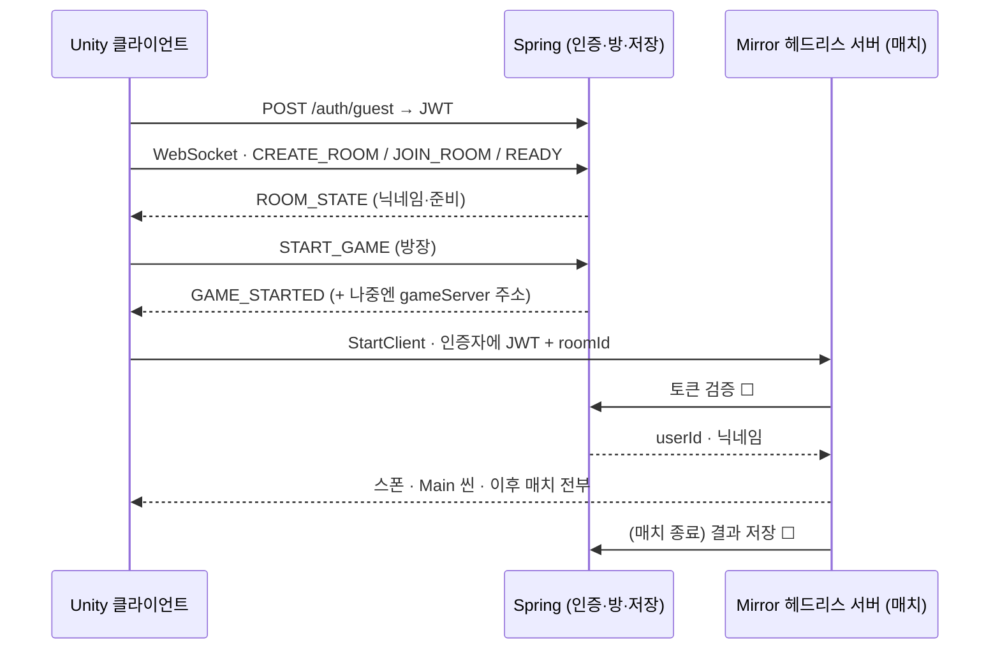
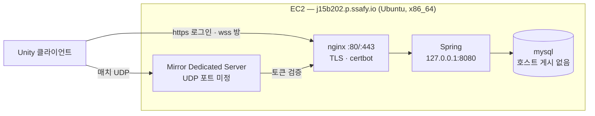

# [Network] 동기화 설계 결정 기록 — Mirror 하이브리드 (S15P21B202-145)

| 항목 | 내용 |
| --- | --- |
| 담당 | 금준영 |
| 기간 | 2026-08-29 ~ (EC2 반영 2026-08-31) |
| Jira | [S15P21B202-145](https://ssafy.atlassian.net/browse/S15P21B202-145) |
| 관련 Epic | [Network] 멀티플레이어 및 동기화 (S15P21B202-15) |

## 목적

구현에 들어가기 전에 **어디서 물리를 돌리고, 누가 상태의 정답을 갖는지**를 정한다. 두 갈래를 비교했다 — Spring 이 중계만 하는 자체 WebSocket 방식(서버에 물리 없음)과, Unity 헤드리스 서버가 물리를 돌리는 **Mirror** 방식. 그리고 그 서버를 **어디서 돌릴지**도 정한다 — 2026-08-31 EC2 를 받았으므로 §4 는 EC2 기준이다.

이 문서는 **계획과 결정**만 담는다. 코드는 없다. `☐` 는 다른 파트의 합의가 필요한 것이다.

## 0. 결정

**2026-08-29 — Mirror 하이브리드.** Spring 은 **인증 · 방 코드 · 저장 · 매치 진입**(게임 서버 주소 전달)을, **Mirror 헤드리스 서버**는 매치 안의 모든 것(플레이어·부품·운반체·메테오·상호작용 판정)을 담당한다.

근거 한 줄: 이 게임의 핵심(부품 조립·운반·용접)은 **여러 명이 같은 물리 오브젝트를 만지는 것**이다. 물리 권위가 없는 서버로 그걸 하려면 오브젝트 소유권·인계·중재를 손으로 짜게 되고, 그건 netcode 를 직접 만드는 일이다. Photon 은 비용으로 제외(팀 결정).

**2026-08-31 — 서버는 EC2.** 이전 판은 EC2 지급 전이라 "내 PC 가 임시로 서버" 를 전제했다. EC2(`j15b202.p.ssafy.io`)를
받았고 Spring 은 이미 거기서 돌고 있으므로(!105·!107), Mirror 서버도 처음부터 EC2 에 올린다. 내 PC 가 서버를 맡는
단계는 **건너뛴다** — 임시 구성을 만들고 곧 버리는 비용이 없어졌다.

경위: 프로젝트 초기(08-25) 구두로 Mirror 가 언급됐으나 **기록이 남지 않았고**, 08-26 백엔드가 raw WebSocket 을 채택해([backend-guidelines §2](../backend-guidelines.md)) 방·인증·재접속을 구현했다. 그 위에서 인게임 동기화까지 Spring 중계로 가는 계획(이 문서의 이전 판)을 세우다 비교해 보니 부품 상호작용에서 막힌다는 것이 분명해져 다시 정했다. 이 기록이 그 공백을 메운다.

## 1. 두 갈래 비교

| | Spring 중계 (자체 WS) | **Mirror** |
| --- | --- | --- |
| 물리 권위 | 서버에 물리 없음 → 아무도 판정 못 함 | Unity 서버가 **실제 물리를 돌림** → 부품·운반체·메테오 위치가 하나 |
| 플레이어 위치 | 직접 구현 (송신·수신·보간) | `NetworkTransform` |
| 공유 물체 (부품·운반체) | 오브젝트마다 소유자를 정하고 넘기는 로직을 손으로. 두 명이 동시에 밀면 각자 화면이 다르고 서버는 중재 불가 | 서버가 시뮬레이션, 클라이언트는 받아 그림. 상호작용은 `[Command]` 로 요청 |
| 새 메커닉마다 | 메시지 타입 + 송수신 + 소유권 + 보간을 매번 추가 | `SyncVar` / `[ClientRpc]` |
| 재접속 | ✅ 이미 됨(30초 유예·`STATE_SYNC`) | ❌ 기본 제공 없음 — 직접(§3-6) |
| 인증·방 코드·저장 | ✅ 이미 됨 | 없음 — **Spring 이 계속 담당** |
| 호스팅 | 컨테이너 2개 | Unity **Dedicated Server 빌드** 프로세스 1개 + Spring |
| Steam 출시 | 서버 비용 계속 | FizzySteamworks 전송 → Steam 릴레이 P2P, 매치 서버 비용 0 |
| 비용 | 0 | 0 (MIT) |
| 이미 쓴 공수 | 전부 유효 | -46/-48 의 **인게임 부분**과 -120 이 무효. 로그인·방 코드·MySQL·로비 유예는 유지 |

Spring 중계로 계속 가면 "서로 보인다"까지는 되지만, 그다음 상호작용(-149)부터는 사실상 Mirror 를 JSON 위에 직접 만드는 일이 된다. 네트워크 담당 한 명이 퍼즐 메커닉이 늘어나는 속도에 맞춰 메시지를 추가하는 구조다.

## 2. 역할 분담

| 남는다 (Spring) | 맡는다 (Mirror) | 빠진다 |
| --- | --- | --- |
| 게스트 로그인·JWT (-40) | 플레이어 스폰·이동·조작 | `PLAYER_MOVE` / `PLAYER_MOVED` 중계 (-120) |
| 방 코드·준비·시작 (-46, -76) | 부품·운반체·메테오 스폰과 물리 | `GameState` 의 위치·`STATE_SYNC` 의 인게임 부분 |
| 로비 단계 재접속 유예 (-48) | 상호작용 판정(잡기·클램프·용접·탑승) | -54 "GameState 필드·게임플레이 메시지" 의 인게임 몫 |
| 닉네임 (-119) | 기절·소생·클리어 판정 → 결과를 Spring 에 저장 | -128 (클라이언트 위치 동기화 — -146~-148 과 중복) |
| MySQL 영구 데이터 | 매치 중 재접속 30초 유예 | |

**1차(이번·다음 스프린트)에 Spring 코드 변경은 최소**다: 게임 서버 주소는 로비에 입력한 호스트를 그대로 쓰므로 `GAME_STARTED` 를 바꿀 필요가 없고, 필요한 것은 **토큰 검증 엔드포인트 하나** ☐ (§3-5). 결과 저장 API 는 클리어 판정을 만들 때.

## 3. 매치 안 설계

### 3-1. 권위 — 서버 권위 물리, 조작은 입력 전송

Unity 헤드리스 서버가 물리를 돌린다. 플레이어 조작은 **입력(`InputFrame`)을 `[Command]` 로 보내고 서버의 `PlayerRig` 가 힘을 가한다**. 클라이언트의 내 캐릭터도 서버가 보낸 위치를 그린다(`NetworkTransform`, 서버→클라이언트). 클라이언트 예측은 하지 않는다.

- 왜: 부품·운반체와의 접촉 결과가 하나여야 한다. 내 캐릭터만 클라이언트 권위로 두면 "내 화면의 나"와 "서버의 나"가 부품을 미는 순간 갈라진다.
- 감수: 조작에 왕복 지연이 붙는다. LAN 5~20ms, EC2 서울 +20ms — 협동 퍼즐에서 체감 안 될 것으로 본다. **거슬리면 내 플레이어만 `ClientToServer`(클라이언트 권위)로 바꾸는 것**을 결정 항목으로 남긴다(-147, -151 실측 후).
- 입력 전송률: 매 물리 틱(100Hz)이 아니라 **변화 시 + 최소 20Hz**. 서버는 마지막 입력을 보관해 매 `FixedUpdate` 에 적용한다.
- 카메라(`OrbitCamera`)는 로컬에 남고, 조준 방향은 입력에 포함해 보낸다.

### 3-2. 네트워크 오브젝트 구성 — 얇은 루트 프리팹 + 양쪽에서 코드 생성

`PlayerRig.Create` · `RagdollBuilder.Build` · `LevelBuilder` · `Prim.*` 는 전부 **프리팹 없이 런타임에 GameObject 를 조립**한다. Mirror 는 네트워크로 스폰하는 오브젝트가 **등록된 프리팹**이어야 한다. 그래서:

| 구분 | 어떻게 |
| --- | --- |
| 플레이어 | `NetworkIdentity` + `NetworkTransform` 만 가진 **얇은 루트 프리팹**을 서버가 스폰. 몸(래그돌)은 서버·클라이언트가 **같은 코드로 그 아래에 생성**. 서버는 물리 래그돌, 클라이언트는 표현용 |
| 정적 지형 (`LevelBuilder`) | 네트워크에 태우지 않는다. 이미 고정 시드(20260825)라 양쪽이 같은 것을 만든다 |
| 동적 오브젝트 (부품·운반체·메테오) | 얇은 루트 프리팹 + 서버 스폰. 물리는 서버, 클라이언트는 `NetworkTransform` 으로 받음. `TickCount` 시드 문제(-152)는 서버가 위치를 정하므로 사라진다 |
| 레이어 | 클라이언트의 원격/내 표현체가 로컬 물리와 충돌하지 않게 `GameLayers` 에 표현용 레이어 추가 ☐ (Puzzle 파트 -57 체계 위에) |

### 3-3. 전송 주기와 보간

Mirror 문서 기준: 동기화 간격은 `NetworkManager` 의 **Send Rate**(예: 10 = 0.1초), `NetworkTransform` 은 **Reliable / Unreliable** 두 종류, 보간은 **스냅샷 보간**이고 버퍼 시간 = 전송 간격 × 배수(3배 권장), 방향 기본값은 서버→클라이언트.

- 시작값: **Send Rate 20 · 버퍼 3배 · 전부 Reliable**(문서 권장). 플레이어를 Unreliable 로 바꿀지는 -151 실측 후.
- 래그돌: **Hips(루트)만 동기화**. 팔다리는 클라이언트 로컬(키네마틱 Hips 를 따라가는 조인트, 또는 rest pose) — -148 에서 둘 중 하나를 고른다. 본 전체 동기화는 트래픽 대비 얻는 게 없다.
- 순간이동(리스폰·재접속)은 보간하지 않고 스냅.
- `NetworkRigidbody` 는 Mirror 에서 **Experimental** 표기 — 플레이어에는 쓰지 않는다. 부품·운반체에 쓸지는 -152 에서 판단하고 기록.

### 3-4. 상호작용 — 요청은 클라이언트, 판정은 서버

`Interactor` · `TractorBeamController` · `PartClamp` · `WeldPoint` · `TransportVehicle` 탑승의 진입점이 클라이언트에서는 **`[Command]` 요청만** 보내고, 판정과 실행은 서버에서만 일어난다. 결과 상태(`PartState`, 누가 들고 있나, 탑승자)는 `SyncVar` 로 모두에게 같다. 두 명이 동시에 잡으면 서버가 하나만 허용한다. **Epic -15 의 "대표 상호작용 1개"는 트랙터 빔으로 부품 들기**로 충족한다(-149).

이 이슈부터 Puzzle 파트 코드에 `[Server]` / `[Command]` / `[ClientRpc]` 가 들어간다. 패턴 한 장을 -149 전에 이 문서에 추가해 김주성과 맞춘다.

### 3-5. 인증 — Spring 의 JWT 를 게임 서버가 Spring 에 물어 확인

커스텀 `NetworkAuthenticator`(Mirror 는 Basic·Device 인증자를 기본 제공하고 커스텀을 허용한다): 클라이언트가 **JWT + roomId** 를 보내면 서버가 Spring 에 토큰을 검증해 userId·닉네임을 확정한다. 다른 방이면 거절. 게임 서버는 부팅 인자로 roomId 를 받아 **1 서버 = 1 매치**로 시작한다(방이 여럿이면 프로세스를 늘린다 — 지금은 범위 밖).

- ☐ Backend: 토큰 검증 엔드포인트(예: 토큰을 주면 userId·nickname 을 돌려주는 REST 하나).
- 버린 대안: 게임 서버가 시크릿을 갖고 직접 검증 — 시크릿이 두 곳에 놓인다.

### 3-6. 재접속 — 30초 유예를 Unity 서버에 재구현

Mirror 는 연결이 끊기면 플레이어 오브젝트를 **바로 지운다**. 팀 규칙(backend-guidelines §5·§6)은 30초 유예 · 복귀 시 그 자리 · 초과 시 제외, 재입장은 기절 상태다. 서버에서 끊긴 오브젝트를 30초 유지하고, 같은 userId(§3-5 인증자가 확정)로 돌아오면 **기존 오브젝트에 권한을 재부여**(`ReplacePlayerForConnection` 패턴), 초과하면 제거·이후 재입장은 DOWNED 스폰(-150). Spring 의 로비 단계 유예(-48)는 그대로.

### 3-7. 진행 판정과 저장

기절·소생·전원 기절·스테이지 클리어 판정은 **매치 서버(Unity)** 가 한다 — backend-guidelines §5-3 "판정은 서버 권위로" 의 "서버"가 Mirror 서버로 바뀐다. 영구 진행도(§5-2)는 매치 서버가 Spring REST 로 저장을 요청한다 ☐ Backend(클리어 판정을 만들 때).

### 3-8. 전송 계층

**KCP(UDP)** 기본. 포트는 **17777**(7777 은 기본값이라 지급 지침이 금지 — §4-3 에서 확정).
WebGL 은 계획에 없으므로(목표는 Steam) `SimpleWebTransport` 는 원래 불필요했지만, **EC2 에서 UDP 를 열 수 없을 때의**
**예비 경로**로는 의미가 있다(wss/443, §4-3). Steam 출시 시 **FizzySteamworks 로 전송만 교체**하면 Steam 릴레이 P2P 가
되어 매치 서버 비용이 0 이 된다 — 코드 구조는 그대로.

## 4. 서버는 EC2

### 4-1. 구성

로비·방까지는 **HTTPS/wss 로 nginx 를 거쳐 Spring**, 매치에 들어가면 **UDP 로 Mirror 서버에 직접** 붙는다. 게임 서버도
토큰 검증을 위해 Spring 을 호출하는데(§3-5), 같은 인스턴스이므로 `127.0.0.1:8080` 으로 부르면 된다 — 외부로 나갈 필요가 없다.

### 4-2. EC2 현황 (2026-08-31 실측 — SSH 로 직접 확인)

| 항목 | 상태 |
| --- | --- |
| 주소 | `j15b202.p.ssafy.io` · Ubuntu (`7.0.0-1011-aws`) · x86_64 |
| 사양 | RAM 15 GiB (사용 1.3 GiB) · 디스크 309 GB (사용 5 GB, 2%) · **스왑 0 B** |
| 방화벽 | UFW **active**, 기본 deny(incoming). 허용은 **22 · 80/tcp · 443/tcp** 뿐 |
| Spring | docker 컨테이너, **`127.0.0.1:8080` 에만** 바인딩. mysql 은 호스트 게시 없음 |
| TLS | nginx + certbot 타이머 동작(다음 갱신 09-01). `docker` 서비스 `enabled` = 재부팅 자동 기동 |
| 확인된 엔드포인트 | `POST /auth/guest` → **200** · `/ws/game` 토큰 없이 → **401**(프록시·인증 정상) |
| **게임 서버 포트** | **아직 열려 있지 않다.** UFW 에 UDP 항목이 없다 — 4-3 |

즉 이전 판의 §4-2(내 PC 현황 — 방화벽 규칙 없음, Docker 꺼짐, Unity 모듈 미설치)는 통째로 무효다. 서버 쪽 준비물 대부분이
이미 갖춰져 있고, **남은 것은 게임 서버용 포트 하나와 서버 빌드의 배치**다.

### 4-3. 게임 서버 포트 — **17777/UDP** (2026-09-01 확정)

- **7777 을 쓰지 않는다.** 7777 은 Mirror·Unity 의 기본값이고, EC2 지급 안내가 기본 포트 변경을 요구한다.
- **17777/UDP** 로 정했다(Infra 결정). 고른 이유: ① 1024 이상 ② 리눅스 임시 포트 범위(32768–60999) **밖**이라
  커널이 나가는 연결에 집어갈 일이 없다 ③ 잘 알려진 서비스와 겹치지 않고, EC2 에 이미 듣고 있는 것도 없다(실측)
  ④ 7777 과 연상돼 기억하기 쉽다. 바꿀 이유가 생기면 아래 세 곳만 함께 고치면 되므로 되돌리는 비용도 싸다.
- **세 곳을 같이** 바꾼다: ① EC2 `sudo ufw allow 17777/udp` ② `KcpTransport` 의 Port(!112 가 들고 있는
  NetworkManager 설정) ③ 클라이언트 기본값(`NetworkSession`). **하나만 바꾸면 조용히 접속 실패한다.**
  UFW 개방은 서버가 실제로 그 포트를 들을 때(-162) 함께 한다 — 듣는 것이 없는 포트를 미리 열어 둘 이유가 없다.
- **UFW 가 실제 게이트다.** 오늘 실측에서 외부로 열린 것은 UFW 허용 목록과 정확히 일치했다(sshd 22 · nginx 80/443).
  포트를 여는 작업은 UFW 한 줄이고, 지급 지침대로 **enable 은 유지**한다.
- **UDP 를 열 수 없다면**: Mirror 의 `SimpleWebTransport` 로 **wss(443)** 를 타면 새 포트가 필요 없다 —
  nginx 에서 경로를 하나 더 프록시하면 된다. 다만 TCP 라 손실 시 뒤 패킷이 밀린다(head-of-line). 물리 동기화에는
  KCP(UDP)가 맞으므로 **1순위는 UDP 개방**, SimpleWeb 은 예비로 둔다.

### 4-4. 빌드와 배포

- **Linux Dedicated Server 빌드는 CI 에서** 만든다. GameCI 이미지에 우리 버전이 그대로 있다(2026-08-31 확인):
  `unityci/editor:ubuntu-6000.5.4f1-linux-il2cpp-3.2.2`. 자체 이미지를 만들 필요가 없고, **누구의 PC 에도 Unity
  서버 빌드 모듈을 설치하지 않아도 된다.**
- 첫 에셋 임포트가 수십 분이므로 **`Library/` 캐시가 사실상 필수**다(러너 볼륨·캐시로 유지).
- 실행은 **systemd 유닛**(`-batchmode -nographics`, `Restart=on-failure`, 재부팅 자동 기동). 컨테이너로 감쌀 수도
  있지만 도커는 UFW 를 우회하므로, 포트 통제를 UFW 한 곳으로 모으는 편이 안전하다.
- 지금은 수동(빌드 → 전송 → 재기동). 이 단계가 -140/-141 자동 배포와 -143 CI 서버 빌드로 대체된다.

### 4-5. 운영 규칙

- **주소가 고정 도메인이다.** 이전 판의 DHCP·IP 변경 공지 문제가 사라졌다. 로비 기본값에 도메인을 박아 두고,
  -126 의 주소 입력란은 **LAN·로컬 개발용**으로 남긴다.
- 서버가 없으면 매치 접속이 실패하며 문구가 뜬다. 감시 장치는 만들지 않는다 — `Restart=on-failure` + 사람이 알아챈다.
- 로그는 `journalctl`. 디스크는 넉넉하지만 회전 설정은 해 둔다.
- **스왑이 0** 이다. 게임 서버를 올린 뒤 메모리를 보고 필요하면 2 GB 를 만든다(지금은 15 GiB 중 1.3 GiB 사용이라 보류).

### 4-6. 내 PC 의 역할 — 서버 아님

이전 판에서 내 PC 가 서버였다. 지금은 **GitLab 러너의 백업**일 뿐이고 서버 역할은 없다. 08-28 러너 중단 1시간과
08-31 MAX_PATH 로 파이프라인이 전멸한 사고가 같은 원인 — 팀 작업이 내 PC 한 대에 묶이는 구조 — 이었고, 그 구조를
없애는 것이 EC2 이전의 목적이다. 게임 서버까지 내 PC 에 두면 그 실수를 반복하는 것이 된다.

## 5. 구현 순서

`Network/` 파일을 이어서 고치므로 **스택 MR**([mr-flow.md](../mr-flow.md) §3). 아래부터 머지. 점수는 1·2·3·5.

| 순서 | 이슈 | 내용 | 점수 | 남의 파일 |
| --- | --- | --- | --- | --- |
| 0 | -145 | 이 기록 (이번 스프린트) | 2 | — |
| 1 | **-160** | Mirror 도입·뼈대 — 패키지(6000.5 컴파일 확인) · NetworkManager(Lobby 오프라인 / Main 온라인) · KCP · Dedicated Server 빌드 프로필 · 서버 1 + 클라 2 접속 | 5 | `LobbyBootstrap`(-125) |
| 2 | **-161** | 매치 진입 — `GAME_STARTED` → `StartClient` · JWT 인증자 · roomId 검사 | 3 | ☐ Backend 검증 API |
| 3 | **-162** | **EC2 운영** — CI 서버 빌드(GameCI) · systemd · `ufw allow 17777/udp` · 첫 접속 실측 | 3 | — |
| 4 | **-146** | 플레이어 네트워크 스폰 — 얇은 루트 + 양쪽 래그돌, 접속·이탈 | 3 | `GameLayers`(김주성) |
| 5 | **-147** | 조작 서버 권위화 — 입력 `[Command]`, 서버 `PlayerRig` | 5 | `PlayerRig`(Character 파트와 공유) |
| 6 | **-148** | 원격 표현 튜닝 — Send Rate·버퍼, Hips 동기화 | 3 | — |
| 7 | **-152** | 월드 오브젝트 네트워크 스폰 — 부품·운반체·메테오 서버 스폰 | 3 | `LevelBuilder`·`TractorBeamController`·`MeteorSpawner`(김주성) |
| 8 | **-149** | 상호작용 서버 권위화 — 트랙터 빔으로 부품 들기 = Epic 완료 기준 | 5 | `Interaction/`·`Parts/`(김주성) |
| 9 | **-150** | 재접속 30초 유예 | 5 | — |
| 10 | **-151** | 실측 기록 | 2 | — |

합계 39점 — 약 두 스프린트. **선행**: -125(로비 씬)·-126(주소 입력) — **둘 다 머지됨(2026-08-31)**. -160 도 !112 로 올라와 있다. 남의 파일을 건드리는 이슈(4·5·7·8)는 MR 전에 그 파트와 설계를 맞춘다.

## 6. 검증 계획 (-151 의 기준)

| 무엇 | 어떻게 | 기대 |
| --- | --- | --- |
| 혼자 | 한 PC 에서 Dedicated Server 빌드 + 에디터 + 클라 빌드 | 두 창에서 서로 보이고 부품을 한쪽이 들면 다른 쪽에도 들린다 |
| 2 PC | **EC2 서버 + 팀원 PC 2대**(같은 Wi-Fi 여도 되고 아니어도 된다 — 인터넷 경유) | 조작 체감 지연 · RTT · 서버/클라 KB/s · Send Rate 후보 비교. **AP isolation 문제가 사라졌다** |
| 재접속 | 한쪽 Wi-Fi 끄고 20초 뒤 켬 | 30초 안이라 같은 자리로 복귀, 상대 화면엔 정지 표시 → 재개 |
| 서버 부하 | 4 클라 접속, 래그돌 4 + 부품 전부 | 헤드리스 서버 CPU — 100Hz 물리가 무겁면 여기서 드러난다 |

## 7. 위험과 대비

| 위험 | 대비 |
| --- | --- |
| ~~Mirror 의 Unity 6000.5 지원~~ | **해소(2026-08-31)** — !112 에서 6000.5.4f1 컴파일이 확인됐다 |
| 서버 권위 조작의 지연이 거슬림 | 내 플레이어만 `ClientToServer` 로 전환(-147 결정 항목) |
| 헤드리스 서버 CPU — 래그돌 4 + 조인트, 100Hz 물리 | -151 에서 측정. 무겁면 서버만 물리 틱 조정(조인트 안정성과 저울질) |
| `NetworkRigidbody` Experimental | 플레이어엔 안 씀. 부품은 `NetworkTransform` 으로 시작 |
| 재접속을 직접 구현 | -150 에 5점. Spring 의 로비 유예는 그대로 |
| Puzzle 코드에 네트워크 속성이 들어감 | 패턴 한 장 공유 후 함께 진행(-149) |
| ~~내 PC 가용성~~ | **해소** — 서버는 EC2 다(§4). 내 PC 는 러너 백업만 |
| **UDP 포트를 못 열 수도 있다** | 4-3 — 1순위 UFW 개방, 막히면 `SimpleWebTransport` 로 wss(443) 경유(지연 손해 감수) |
| EC2 단일 인스턴스에 Spring·mysql·게임 서버가 함께 | 지금 여력은 충분(RAM 15 GiB 중 1.3 GiB). -151 에서 4인 접속 시 CPU·메모리를 재고, **스왑 0** 이므로 필요하면 2 GB 확보 |
| Backend 역할 축소로 인한 마찰 | §2 표로 남는 것·빠지는 것을 분명히. -120·-54·-128 은 Backend 와 정리 |

## 8. 버린 대안

- **Spring 중계 + 자체 WebSocket 으로 인게임까지** — 이 문서 이전 판. 위치 동기화까진 되지만 상호작용에서 netcode 를 직접 쓰게 된다(§1).
- **Photon** — 비용(팀 결정).
- **Netcode for GameObjects** — 같은 범주지만 물리 오브젝트 동기화와 Steam 전송의 성숙도에서 Mirror 를 택함. Multiplayer Center 패키지가 프로젝트에 있는 것은 위저드일 뿐 결정이 아니다.
- **호스트 클라이언트 모드**(한 플레이어가 서버 겸임) — 인터넷 플레이에 NAT 통과가 필요하고 호스트만 지연 0. 헤드리스 서버가 있으니 불필요. LAN 시연 급할 때 임시로는 가능.
- **서버가 시드를 내려주고 클라이언트가 각자 배치** — 서버 권위 스폰이 있으니 불필요(-152).
- **UDP 브로드캐스트 서버 발견** — 공용 Wi-Fi 가 막는다. -126 수동 입력 유지.

## 남은 것 / 후속 이슈

- Backend(최재현)와 §2 표 확정 — 토큰 검증 API ☐ · compose 파일 ☐ · -120/-54/-128 정리. 이 대화 뒤 `backend-guidelines.md` §5·§6 의 "서버" 가 매치 서버(Mirror)를 뜻하도록 한 줄 갱신(그 파일은 열린 MR !71·!72 가 갖고 있어 머지 뒤).
- Puzzle(김주성)과 `GameLayers` 표현 레이어 ☐ · -149/-152 설계.
- 구현: §5 순서. Mirror 패턴 한 장은 -149 전에 이 문서에 추가.
- 서버 배치: 포트는 **17777/UDP 로 확정**(§4-3). 남은 것은 -162 의 실행 — CI 서버 빌드 · systemd · UFW 한 줄.
- CI·CD: -143 에 GameCI 서버 빌드 추가 → -140/-141 자동 배포. -139~-142 중 Spring 이전 몫은 !105·!107 로 끝났다.
