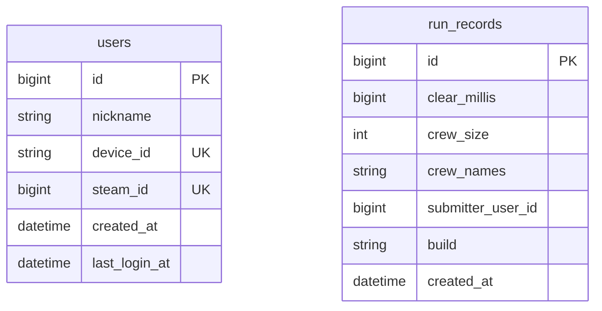

# 04. DB 구조·백업·복원

## 현재 인계 상태

**저장소에 최신 운영 DB 덤프가 없습니다. 운영 DB에 접속하거나 실제 덤프를 생성하지 않았습니다.** 이 문서나 엔티티 설명은 최신 덤프를 대체하지 않습니다. 실제 파일을 받은 뒤 [db/README](db/README.md)의 확인 기록을 채워야 제출 항목 3이 완료됩니다.

## 영속 데이터와 비영속 데이터

MySQL DB 이름/앱 계정은 `metagame`입니다. 운영 compose는 DB 포트를 외부로 공개하지 않으며 컨테이너 내부에서는 `mysql:3306`으로 연결합니다. 운영 `mysql-data`와 개발 `mysql-dev-data`는 별도 볼륨입니다. 실제 Docker 볼륨 이름에는 compose 프로젝트 접두사가 붙습니다. `docker volume ls`와 compose 설정으로 확인합니다.

| 엔티티 / 테이블 | 필드(논리 이름) | 제약·의미 |
| --- | --- | --- |
| `User` / `users` | id, nickname, deviceId, steamId, createdAt, lastLoginAt | id 자동 증가; deviceId 유일/필수/64자, nickname 필수/20자. API 입력은 최대 12자. steamId 유일·nullable |
| `RunRecord` / `run_records` | id, clearMillis, crewSize, crewNames, submitterUserId, build, createdAt | id 자동 증가; crewNames 100자, build 80자 nullable. 인원·시간 인덱스 |

실제 물리 컬럼 이름/타입은 Hibernate naming strategy와 기존 스키마의 영향을 받으므로 `SHOW CREATE TABLE`로 확정합니다. `submitterUserId`는 사용자 ID를 담는 값이지만 JPA 관계/FK 선언은 없습니다. DB에 FK가 있다고 가정하지 않습니다.



위 ERD는 소스에서 유도한 설명용 구조입니다. 두 테이블을 잇는 물리 FK는 표시하지 않았습니다. 방·플레이어 준비·재접속/릴레이 상태는 메모리 상태이므로 SQL 복원으로 진행 중인 판이 살아나지 않습니다. 플레이 로그는 호스트 파일이고 DB 덤프에 들어가지 않습니다.

## 최신 백업 생성(운영 서버, Bash)

배포/스키마 변경을 멈추고 대상이 운영 DB인지 확인합니다. `--single-transaction`은 InnoDB 데이터의 일관된 스냅샷을 위한 옵션이며 백업 중 DDL 변경까지 안전하게 만드는 옵션은 아닙니다.

```bash
# 저장소 루트. 비밀값은 이미 실행 중인 MySQL 컨테이너의 환경을 사용한다.
bash exec/scripts/backup-db.sh metagame-mysql exec/db
```

도구는 SQL.gz와 SHA-256 파일을 생성하고 실패 시 완료 파일을 남기지 않습니다. `docker exec` 권한이 필요합니다. **기존 볼륨 암호를 변경했는데 컨테이너 환경이 예전 값이면 실패**하므로 DBA에게 현재 접속 정보를 확인합니다. 출력 파일에는 사용자 식별자·닉네임·기록이 들어갈 수 있으므로 지정된 인수 경로로 전달합니다.

기록할 정보:

- UTC 백업 생성 시각, 운영/개발 구분, 서버·DB 이름, MySQL 버전
- 기준 소스 커밋·배포 버전, 백업 파일명·바이트·SHA-256
- `SHOW TABLES`, 두 테이블의 `SHOW CREATE TABLE`, 각 `COUNT(*)`
- 복원 테스트 대상/시각, 복원 후 행 수, 로그인·랭킹 결과

## 별도 DB에서 복원 검증

대상 DB의 데이터를 교체하므로 **운영 DB가 아닌 새 검증용 DB/컨테이너**에서 먼저 수행합니다. 아래 `metagame-restore-mysql`은 따로 준비한 MySQL 8.0 컨테이너이며 빈 `metagame` DB와 앱 계정이 있어야 합니다. 앱은 중지한 상태에서 진행합니다.

```bash
# 백업 폴더에서 실제 파일명을 지정한다.
sha256sum -c metagame-YYYYMMDDTHHMMSSZ.sql.gz.sha256
gzip -t metagame-YYYYMMDDTHHMMSSZ.sql.gz
set -o pipefail
gzip -dc metagame-YYYYMMDDTHHMMSSZ.sql.gz | docker exec -i metagame-restore-mysql \
  sh -c 'MYSQL_PWD="$MYSQL_ROOT_PASSWORD" exec mysql --user=root --default-character-set=utf8mb4 metagame'
```

SQL 실행 오류/파이프라인 종료 코드가 0인지 확인하고, 원본과 테이블 수·행 수·인덱스를 대조합니다. 앱의 `DB_URL`을 검증용 DB로 연결하여 게스트 로그인·랭킹 조회를 확인합니다. 예: `GET /leaderboard?crew=2&limit=10`. 검증이 완료된 뒤 점검 시간에 운영 복원을 수행하며 직전 운영 백업도 보존합니다.

이 백업은 앱 DB만 담습니다. MySQL 사용자·권한 시스템 테이블, `.env`, TLS, 릴레이 상태, 로그 디렉터리는 별도로 복구합니다. 기존 계정의 deviceId를 모르면서 새 장치로 로그인하면 새 게스트 계정이 만들어질 수 있습니다.

## 데이터 보존 주의

- `application.yml`은 `ddl-auto: update`입니다. 구버전 JAR로 되돌려도 자동으로 스키마가 롤백되지 않습니다.
- 기존 서버에서 `docker compose down -v`를 실행하면 DB 볼륨이 삭제될 수 있습니다. 암호 오류나 재배포 해결 방법으로 사용하지 않습니다.
- DB/JWT 비밀을 바꾸면 로그인·토큰 검증에 영향이 있습니다. JWT 교체 후 기존 토큰은 재로그인이 필요합니다.
- 로그는 운영 `/var/log/metagame-runlogs`, 개발 `/var/log/metagame-dev-runlogs`에 분리되어 있으며 기본 보관 14일입니다. DB와 별도 보관합니다.
